Predicting bacteriophage lifestyle from genome data
================
Chris Dargham
25 October 2026

- [Introduction](#introduction)
  - [Workflow](#workflow)
- [1. Data preparation](#1-data-preparation)
- [2. Exploratory analysis](#2-exploratory-analysis)
  - [2.1 Train/test split](#21-traintest-split)
- [3. Regression: what explains genome
  size?](#3-regression-what-explains-genome-size)
  - [3.1 Simple linear regression](#31-simple-linear-regression)
  - [3.2 Multiple regression](#32-multiple-regression)
  - [3.3 Interaction and polynomial
    terms](#33-interaction-and-polynomial-terms)
  - [3.4 Model comparison and
    diagnostics](#34-model-comparison-and-diagnostics)
  - [3.5 One value per cluster](#35-one-value-per-cluster)
- [4. Classical classification](#4-classical-classification)
  - [4.1 Logistic regression](#41-logistic-regression)
  - [4.2 LDA and QDA](#42-lda-and-qda)
  - [4.3 10-fold cross-validation](#43-10-fold-cross-validation)
  - [4.4 Bootstrap](#44-bootstrap)
  - [4.5 Variable selection](#45-variable-selection)
  - [4.6 Decision threshold](#46-decision-threshold)
- [5. Trees and ensembles](#5-trees-and-ensembles)
  - [5.1 Decision tree and pruning](#51-decision-tree-and-pruning)
  - [5.2 Bagging, random forest and
    boosting](#52-bagging-random-forest-and-boosting)
  - [5.3 All models on the random
    split](#53-all-models-on-the-random-split)
- [6. Validation check: are related phages leaking into the test
  set?](#6-validation-check-are-related-phages-leaking-into-the-test-set)
  - [6.1 Cluster structure](#61-cluster-structure)
  - [6.2 A baseline with no genome
    data](#62-a-baseline-with-no-genome-data)
  - [6.3 Random split vs held-out
    clusters](#63-random-split-vs-held-out-clusters)
  - [6.4 Grouped 10-fold
    cross-validation](#64-grouped-10-fold-cross-validation)
  - [6.5 Accuracy per cluster](#65-accuracy-per-cluster)
  - [6.6 Which features help on new clusters?
    (ablation)](#66-which-features-help-on-new-clusters-ablation)
  - [6.7 Permutation test](#67-permutation-test)
- [7. Unsupervised learning](#7-unsupervised-learning)
  - [7.1 PCA](#71-pca)
  - [7.2 k-means](#72-k-means)
  - [7.3 Hierarchical clustering](#73-hierarchical-clustering)
- [8. Predicting the unlabelled
  phages](#8-predicting-the-unlabelled-phages)
- [9. Conclusions](#9-conclusions)
- [Session information](#session-information)

``` r
# Install any missing package (only happens the first time)
packages <- c("readxl", "dplyr", "tidyr", "stringr", "ggplot2", "knitr",
              "MASS", "pROC", "caret", "boot", "bestglm",
              "rpart", "rpart.plot", "randomForest", "gbm",
              "factoextra", "cluster", "patchwork")
missing <- packages[!packages %in% rownames(installed.packages())]
if (length(missing) > 0) install.packages(missing, repos = "https://cloud.r-project.org")

library(readxl)
library(dplyr)
library(tidyr)
library(stringr)
library(ggplot2)
library(MASS)          # lda, qda, stepAIC
library(pROC)          # ROC curves and AUC
library(caret)         # data partition, confusion matrix, cross-validation
library(boot)          # bootstrap
library(bestglm)       # best subset selection
library(rpart)         # classification trees
library(rpart.plot)
library(randomForest)  # bagging and random forest
library(gbm)           # boosting
library(factoextra)    # PCA and clustering plots
library(cluster)       # silhouette
library(patchwork)     # combine several ggplot figures into one panel

select <- dplyr::select   # MASS also has a select() function

# Settings
SEED      <- 123
N_REPEATS <- 10    # repeated train/test splits in section 6.3
N_PERM    <- 100   # label permutations in section 6.7 (lower it for a faster run)
dir.create("output",  showWarnings = FALSE)
dir.create("figures", showWarnings = FALSE)

# One look for all figures: same theme everywhere, and lifestyle always has the same two colours
theme_set(theme_bw(base_size = 12) +
          theme(plot.title = element_text(face = "bold"), legend.position = "bottom"))
life_cols <- c(Temperate = "#0072B2", Virulent = "#D55E00")
test_cols <- c("Random phages" = "grey65", "Held-out clusters" = "#009E73")

# Small helpers used for numbers quoted in the text
r3 <- function(x) format(round(as.numeric(x), 3), nsmall = 3)
pv <- function(p) format.pval(p, digits = 2)
```

# Introduction

Bacteriophages are viruses that infect bacteria. They have two main
lifestyles. **Virulent** phages always kill the host cell. **Temperate**
phages can also insert their genome into the host and stay there until
they switch back to killing it. In the Actinobacteriophage Database
(PhagesDB), most phages have a lifestyle label, but some do not.

The question of this project is: **can the lifestyle of a phage be
predicted from simple genome annotations, and how well would such a
model work on new phages?**

The project applies the methods from three data mining course phases to
this question: regression (Phase I), classical classifiers with
resampling and model selection (Phase II), and tree ensembles and
unsupervised learning (Phase III). A large part of the work is about
**validation**: checking whether the accuracy we measure is the accuracy
we would get on new data.

## Workflow

1.  **Data preparation**: filter the database, build features, keep a
    record of how many phages remain at each step.
2.  **Exploratory analysis**: distributions and first relationships with
    lifestyle.
3.  **Regression**: what explains genome size, and is lifestyle part of
    it?
4.  **Classical classification**: logistic regression, LDA, QDA,
    cross-validation, bootstrap, variable selection, threshold choice.
5.  **Trees and ensembles**: decision tree, bagging, random forest,
    boosting.
6.  **Validation check**: are related phages leaking information between
    training and test data? Grouped cross-validation, a no-genomics
    baseline, feature ablation and a permutation test.
7.  **Unsupervised learning**: PCA, k-means and hierarchical clustering.
8.  **Prediction** of the unlabelled phages.

All result tables are written to `output/` and all figures to
`figures/`.

# 1. Data preparation

The data were exported in tabular form from PhagesDB
(<https://phagesdb.org/phages/>) and saved as `data/phages_db.xlsx`. We
keep finished genomes that have genome length, GC content, ORF count and
morphotype.

``` r
raw <- read_excel("data/phages_db.xlsx", sheet = "Sheet1")
n_finished <- sum(raw$Finished.Sequence. %in% c(TRUE, "True", "TRUE"))

clean_df <- raw %>%
  filter(Finished.Sequence. %in% c(TRUE, "True", "TRUE")) %>%
  transmute(
    phage_name = Phage.Name,
    temperate  = Temperate.,          # "True" / "False" / "None"
    cluster    = Cluster,
    host_genus = str_extract(Host, "^[^ ]+"),
    morphotype = Morphotype,
    genome_len = suppressWarnings(as.numeric(Genome.Length.bp.)),
    gc_percent = suppressWarnings(as.numeric(GC.)),
    end_type   = End.Type,
    orfs       = suppressWarnings(as.numeric(X..ORFs)),
    tm_rnas    = suppressWarnings(as.numeric(X..tmRNAs)),
    t_rnas     = suppressWarnings(as.numeric(X..tRNAs))
  ) %>%
  filter(!is.na(morphotype), !is.na(genome_len), !is.na(gc_percent), !is.na(orfs)) %>%
  mutate(
    genome_kb      = genome_len / 1000,
    orfs_per_kb    = orfs / genome_kb,
    t_rnas_per_kb  = t_rnas / genome_kb,
    tm_rnas_per_kb = tm_rnas / genome_kb,
    lifestyle = case_when(
      temperate %in% c(TRUE, "True", "TRUE")    ~ "Temperate",
      temperate %in% c(FALSE, "False", "FALSE") ~ "Virulent",
      TRUE ~ NA_character_),
    # a missing end type becomes its own category, so these phages are not dropped
    end_type   = ifelse(is.na(end_type) | end_type == "None", "Unknown", end_type),
    # each "Singleton" phage is its own group
    cluster_id = ifelse(cluster %in% c("Singleton", "None") | is.na(cluster), phage_name, cluster),
    morphotype = factor(morphotype),
    end_type   = factor(end_type),
    host_genus = factor(host_genus),
    lifestyle  = factor(lifestyle, levels = c("Temperate", "Virulent"))
  )

labeled_df   <- clean_df %>% filter(!is.na(lifestyle)) %>% droplevels()
unlabeled_df <- clean_df %>% filter(is.na(lifestyle))

cohort <- data.frame(
  Step   = c("Rows in the export", "Finished genomes", "With complete core annotations",
             "  of which labelled", "  of which unlabelled"),
  Phages = c(nrow(raw), n_finished, nrow(clean_df), nrow(labeled_df), nrow(unlabeled_df))
)
knitr::kable(cohort, caption = "Number of phages at each preparation step")
```

| Step                           | Phages |
|:-------------------------------|-------:|
| Rows in the export             |   5580 |
| Finished genomes               |   5580 |
| With complete core annotations |   4320 |
| of which labelled              |   4083 |
| of which unlabelled            |    237 |

Number of phages at each preparation step

``` r
colSums(is.na(clean_df %>% select(-lifestyle)))
```

    ##     phage_name      temperate        cluster     host_genus     morphotype     genome_len     gc_percent       end_type 
    ##              0              0              0              0              0              0              0              0 
    ##           orfs        tm_rnas         t_rnas      genome_kb    orfs_per_kb  t_rnas_per_kb tm_rnas_per_kb     cluster_id 
    ##              0              0              0              0              0              0              0              0

All rows in this export are finished genomes. Most of the removed rows
(1259) have no morphotype; one has no usable GC value.

The features used later are genome length (kb), GC content, number of
ORFs (predicted genes), tRNA and tmRNA counts, their densities per kb,
morphotype, DNA end type and host genus. The PhagesDB **cluster** (a
group of closely related phages) is kept, but only for validation. It is
never used as a predictor.

# 2. Exploratory analysis

``` r
numeric_vars <- c("genome_kb", "gc_percent", "orfs", "t_rnas", "tm_rnas",
                  "orfs_per_kb", "t_rnas_per_kb", "tm_rnas_per_kb")
summary(clean_df[, numeric_vars])
```

    ##    genome_kb        gc_percent         orfs           t_rnas          tm_rnas         orfs_per_kb     t_rnas_per_kb    
    ##  Min.   : 14.27   Min.   :41.20   Min.   : 20.0   Min.   : 0.000   Min.   :0.00000   Min.   :0.8768   Min.   :0.00000  
    ##  1st Qu.: 49.97   1st Qu.:61.50   1st Qu.: 78.0   1st Qu.: 0.000   1st Qu.:0.00000   1st Qu.:1.4831   1st Qu.:0.00000  
    ##  Median : 55.07   Median :63.90   Median : 94.0   Median : 0.000   Median :0.00000   Median :1.6068   Median :0.00000  
    ##  Mean   : 62.79   Mean   :63.45   Mean   :101.7   Mean   : 3.244   Mean   :0.05764   Mean   :1.6191   Mean   :0.03089  
    ##  3rd Qu.: 68.59   3rd Qu.:66.50   3rd Qu.:103.0   3rd Qu.: 1.000   3rd Qu.:0.00000   3rd Qu.:1.7536   3rd Qu.:0.01980  
    ##  Max.   :200.05   Max.   :72.70   Max.   :352.0   Max.   :47.000   Max.   :1.00000   Max.   :2.2571   Max.   :0.53073  
    ##  tm_rnas_per_kb     
    ##  Min.   :0.0000000  
    ##  1st Qu.:0.0000000  
    ##  Median :0.0000000  
    ##  Mean   :0.0004064  
    ##  3rd Qu.:0.0000000  
    ##  Max.   :0.0179420

``` r
table(clean_df$lifestyle, useNA = "ifany")
```

    ## 
    ## Temperate  Virulent      <NA> 
    ##      2254      1829       237

``` r
sort(table(clean_df$morphotype), decreasing = TRUE)
```

    ## 
    ## SIPHO   MYO  PODO TECTI 
    ##  3971   277    69     3

``` r
sort(table(clean_df$host_genus), decreasing = TRUE)
```

    ## 
    ##     Mycobacterium    Microbacterium          Gordonia      Arthrobacter      Streptomyces       Rhodococcus 
    ##              2605               463               460               442               220                54 
    ## Propionibacterium    Curtobacterium   Corynebacterium    Brevibacterium      Actinoplanes            Rothia 
    ##                48                13                10                 2                 1                 1 
    ##      Tsukamurella 
    ##                 1

``` r
table(clean_df$end_type, clean_df$lifestyle, useNA = "ifany")
```

    ##                            
    ##                             Temperate Virulent <NA>
    ##   3' Sticky Overhang             2157      497   64
    ##   5' Sticky Overhang                1        0    0
    ##   Circularly Permuted              40     1034  137
    ##   Covalent Terminal Protein         0        2    5
    ##   Direct Terminal Repeat            2      213   24
    ##   Unknown                          54       83    7

``` r
p1 <- ggplot(clean_df, aes(x = genome_kb)) +
  geom_histogram(bins = 40, fill = "grey60", color = "white") +
  labs(title = "A. Genome length", x = "Genome length (kb)", y = "Phages")

p2 <- ggplot(clean_df, aes(x = gc_percent)) +
  geom_histogram(bins = 40, fill = "grey60", color = "white") +
  labs(title = "B. GC content", x = "GC (%)", y = "Phages")

p3 <- ggplot(labeled_df, aes(x = lifestyle, y = genome_kb, fill = lifestyle)) +
  geom_boxplot(outlier.alpha = 0.3) +
  scale_fill_manual(values = life_cols) +
  labs(title = "C. Genome length by lifestyle", x = "", y = "Genome length (kb)") +
  theme(legend.position = "none")

p4 <- ggplot(labeled_df, aes(x = genome_kb, y = orfs_per_kb, color = lifestyle)) +
  geom_point(alpha = 0.4, size = 1) +
  scale_color_manual(values = life_cols) +
  labs(title = "D. Genome length vs coding density", x = "Genome length (kb)", y = "ORFs per kb", color = "")

(p1 + p2) / (p3 + p4)
```

<div class="figure" style="text-align: center">

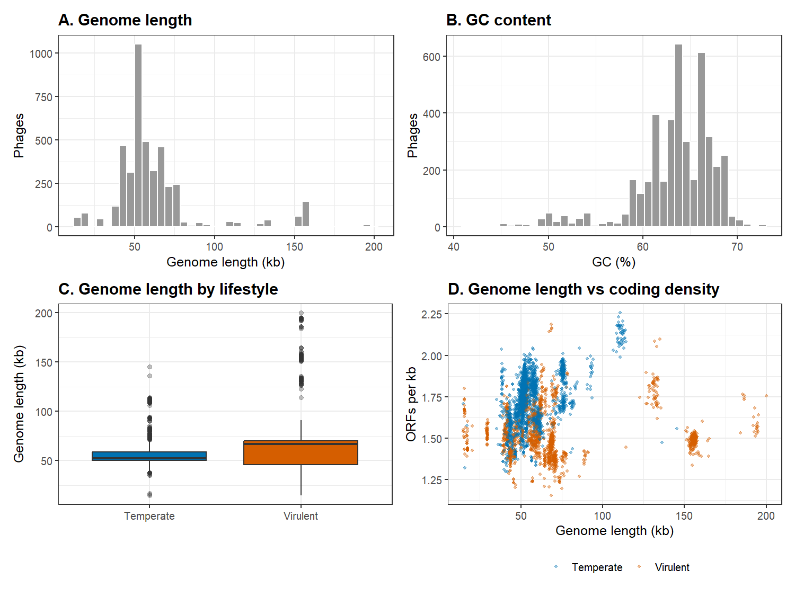
<p class="caption">

Overview of the data. A and B: distributions of genome length and GC
content. C and D: labelled phages coloured by lifestyle; the largest
genomes are mostly virulent.
</p>

</div>

We keep 4320 finished genomes: 2254 temperate, 1829 virulent and 237
without a label. Genome length is right-skewed, with most genomes
between 40 and 70 kb and a few up to 200 kb. GC content is high (mostly
60 to 68%). Most genomes have no tRNA gene, but some have many.

The dataset is unbalanced in two ways. Over 90% of the phages are
siphoviruses (SIPHO), and about 60% were isolated on *Mycobacterium*.
Our conclusions mostly describe these groups.

Two patterns stand out. First, DNA end type is strongly linked to
lifestyle: phages with a 3’ sticky overhang are mostly temperate, while
circularly permuted and direct terminal repeat genomes are almost all
virulent. Second, the largest genomes (above about 100 kb) are mostly
virulent.

## 2.1 Train/test split

One stratified 70/30 split of the labelled phages is shared by all
classifiers in sections 4 and 5, so their test results can be compared
directly.

``` r
set.seed(SEED)
train_index <- createDataPartition(labeled_df$lifestyle, p = 0.7, list = FALSE)
prop.table(table(labeled_df$lifestyle[train_index]))
```

    ## 
    ## Temperate  Virulent 
    ## 0.5519412 0.4480588

``` r
prop.table(table(labeled_df$lifestyle[-train_index]))
```

    ## 
    ## Temperate  Virulent 
    ## 0.5522876 0.4477124

# 3. Regression: what explains genome size?

The response is the natural log of genome length (`log_kb`). The log
reduces the skew, and a coefficient `b` means the genome is `exp(b)`
times larger. Predictors are lifestyle, standardised GC content
(`gc_z`), host genus (genera with fewer than 100 labelled phages are
pooled as “Other”) and morphotype.

``` r
big_hosts <- names(which(table(labeled_df$host_genus) >= 100))

reg_df <- labeled_df %>%
  mutate(
    log_kb     = log(genome_kb),
    gc_z       = as.numeric(scale(gc_percent)),
    host_group = factor(ifelse(host_genus %in% big_hosts, as.character(host_genus), "Other"))
  )
table(reg_df$host_group)
```

    ## 
    ##   Arthrobacter       Gordonia Microbacterium  Mycobacterium          Other   Streptomyces 
    ##            403            418            372           2591             98            201

## 3.1 Simple linear regression

``` r
m1 <- lm(log_kb ~ lifestyle, data = reg_df)
summary(m1)
```

    ## 
    ## Call:
    ## lm(formula = log_kb ~ lifestyle, data = reg_df)
    ## 
    ## Residuals:
    ##      Min       1Q   Median       3Q      Max 
    ## -1.42953 -0.10961 -0.03078  0.10487  1.17238 
    ## 
    ## Coefficients:
    ##                   Estimate Std. Error t value Pr(>|t|)    
    ## (Intercept)       4.006471   0.008262 484.920   <2e-16 ***
    ## lifestyleVirulent 0.119707   0.012345   9.697   <2e-16 ***
    ## ---
    ## Signif. codes:  0 '***' 0.001 '**' 0.01 '*' 0.05 '.' 0.1 ' ' 1
    ## 
    ## Residual standard error: 0.3923 on 4081 degrees of freedom
    ## Multiple R-squared:  0.02252,    Adjusted R-squared:  0.02228 
    ## F-statistic: 94.04 on 1 and 4081 DF,  p-value: < 2.2e-16

``` r
ph_test <- t.test(log_kb ~ lifestyle, data = reg_df)
ph_test
```

    ## 
    ##  Welch Two Sample t-test
    ## 
    ## data:  log_kb by lifestyle
    ## t = -8.9612, df = 2239.3, p-value < 2.2e-16
    ## alternative hypothesis: true difference in means between group Temperate and group Virulent is not equal to 0
    ## 95 percent confidence interval:
    ##  -0.14590343 -0.09351112
    ## sample estimates:
    ## mean in group Temperate  mean in group Virulent 
    ##                4.006471                4.126178

``` r
m2 <- lm(log_kb ~ gc_z, data = reg_df)
summary(m2)
```

    ## 
    ## Call:
    ## lm(formula = log_kb ~ gc_z, data = reg_df)
    ## 
    ## Residuals:
    ##      Min       1Q   Median       3Q      Max 
    ## -1.42496 -0.15351 -0.07048  0.20275  1.27573 
    ## 
    ## Coefficients:
    ##              Estimate Std. Error t value Pr(>|t|)    
    ## (Intercept)  4.060094   0.006154 659.764   <2e-16 ***
    ## gc_z        -0.052781   0.006155  -8.576   <2e-16 ***
    ## ---
    ## Signif. codes:  0 '***' 0.001 '**' 0.01 '*' 0.05 '.' 0.1 ' ' 1
    ## 
    ## Residual standard error: 0.3932 on 4081 degrees of freedom
    ## Multiple R-squared:  0.0177, Adjusted R-squared:  0.01746 
    ## F-statistic: 73.55 on 1 and 4081 DF,  p-value: < 2.2e-16

In Model 1, virulent genomes are on average 13% larger than temperate
genomes, and the Welch t-test agrees. But lifestyle alone explains only
2.3% of the variance. In Model 2, one standard deviation more GC goes
with a genome about 5% smaller, again with a small R² (0.018).

## 3.2 Multiple regression

``` r
m3 <- lm(log_kb ~ lifestyle + gc_z + host_group + morphotype, data = reg_df)
summary(m3)
```

    ## 
    ## Call:
    ## lm(formula = log_kb ~ lifestyle + gc_z + host_group + morphotype, 
    ##     data = reg_df)
    ## 
    ## Residuals:
    ##      Min       1Q   Median       3Q      Max 
    ## -1.16381 -0.11496  0.01147  0.10346  1.34992 
    ## 
    ## Coefficients:
    ##                           Estimate Std. Error t value Pr(>|t|)    
    ## (Intercept)               4.305911   0.024564 175.290  < 2e-16 ***
    ## lifestyleVirulent         0.169506   0.010200  16.619  < 2e-16 ***
    ## gc_z                     -0.088281   0.004615 -19.129  < 2e-16 ***
    ## host_groupGordonia        0.386679   0.018978  20.375  < 2e-16 ***
    ## host_groupMicrobacterium -0.019984   0.020653  -0.968 0.333284    
    ## host_groupMycobacterium   0.498144   0.015320  32.516  < 2e-16 ***
    ## host_groupOther          -0.117320   0.030350  -3.866 0.000113 ***
    ## host_groupStreptomyces    0.504877   0.023503  21.481  < 2e-16 ***
    ## morphotypePODO           -1.166230   0.055410 -21.047  < 2e-16 ***
    ## morphotypeSIPHO          -0.741615   0.018735 -39.585  < 2e-16 ***
    ## ---
    ## Signif. codes:  0 '***' 0.001 '**' 0.01 '*' 0.05 '.' 0.1 ' ' 1
    ## 
    ## Residual standard error: 0.2676 on 4073 degrees of freedom
    ## Multiple R-squared:  0.5459, Adjusted R-squared:  0.5449 
    ## F-statistic:   544 on 9 and 4073 DF,  p-value: < 2.2e-16

``` r
confint(m3)
```

    ##                                2.5 %      97.5 %
    ## (Intercept)               4.25775085  4.35407054
    ## lifestyleVirulent         0.14950896  0.18950320
    ## gc_z                     -0.09732869 -0.07923238
    ## host_groupGordonia        0.34947132  0.42388749
    ## host_groupMicrobacterium -0.06047460  0.02050622
    ## host_groupMycobacterium   0.46810873  0.52817955
    ## host_groupOther          -0.17682227 -0.05781681
    ## host_groupStreptomyces    0.45879730  0.55095636
    ## morphotypePODO           -1.27486477 -1.05759545
    ## morphotypeSIPHO          -0.77834587 -0.70488491

Adding host and morphotype raises the adjusted R² to 0.545. So genome
size depends mostly on morphotype and host. Siphoviruses are about half
the size of myoviruses (factor 0.476). With these variables fixed,
virulent genomes are 18% larger than temperate ones (factor 1.185 (95%
CI 1.161 to 1.209).

## 3.3 Interaction and polynomial terms

``` r
m4 <- lm(log_kb ~ lifestyle * gc_z + host_group + morphotype, data = reg_df)
summary(m4)
```

    ## 
    ## Call:
    ## lm(formula = log_kb ~ lifestyle * gc_z + host_group + morphotype, 
    ##     data = reg_df)
    ## 
    ## Residuals:
    ##      Min       1Q   Median       3Q      Max 
    ## -1.14686 -0.11161  0.01842  0.11384  1.36459 
    ## 
    ## Coefficients:
    ##                           Estimate Std. Error t value Pr(>|t|)    
    ## (Intercept)               4.332041   0.024967 173.508  < 2e-16 ***
    ## lifestyleVirulent         0.163061   0.010237  15.928  < 2e-16 ***
    ## gc_z                     -0.132047   0.009406 -14.039  < 2e-16 ***
    ## host_groupGordonia        0.377118   0.019000  19.849  < 2e-16 ***
    ## host_groupMicrobacterium -0.047514   0.021220  -2.239   0.0252 *  
    ## host_groupMycobacterium   0.471447   0.016068  29.341  < 2e-16 ***
    ## host_groupOther          -0.133995   0.030409  -4.406 1.08e-05 ***
    ## host_groupStreptomyces    0.510625   0.023449  21.776  < 2e-16 ***
    ## morphotypePODO           -1.165107   0.055225 -21.097  < 2e-16 ***
    ## morphotypeSIPHO          -0.741510   0.018672 -39.712  < 2e-16 ***
    ## lifestyleVirulent:gc_z    0.059913   0.011231   5.334 1.01e-07 ***
    ## ---
    ## Signif. codes:  0 '***' 0.001 '**' 0.01 '*' 0.05 '.' 0.1 ' ' 1
    ## 
    ## Residual standard error: 0.2667 on 4072 degrees of freedom
    ## Multiple R-squared:  0.549,  Adjusted R-squared:  0.5479 
    ## F-statistic: 495.7 on 10 and 4072 DF,  p-value: < 2.2e-16

``` r
anova(m3, m4)
```

    ## Analysis of Variance Table
    ## 
    ## Model 1: log_kb ~ lifestyle + gc_z + host_group + morphotype
    ## Model 2: log_kb ~ lifestyle * gc_z + host_group + morphotype
    ##   Res.Df    RSS Df Sum of Sq      F    Pr(>F)    
    ## 1   4073 291.73                                  
    ## 2   4072 289.70  1    2.0245 28.456 1.011e-07 ***
    ## ---
    ## Signif. codes:  0 '***' 0.001 '**' 0.01 '*' 0.05 '.' 0.1 ' ' 1

``` r
grid_int <- expand.grid(
  gc_z       = seq(min(reg_df$gc_z), max(reg_df$gc_z), length.out = 100),
  lifestyle  = levels(reg_df$lifestyle),
  host_group = "Mycobacterium",
  morphotype = "SIPHO"
)
grid_int$fit <- predict(m4, newdata = grid_int)

ggplot(grid_int, aes(x = gc_z, y = exp(fit), colour = lifestyle)) +
  geom_line(linewidth = 1.2) +
  scale_colour_manual(values = life_cols) +
  labs(title = "Interaction: lifestyle x GC",
       x = "GC content (standardised)", y = "Fitted genome length (kb)", colour = "")
```

<div class="figure" style="text-align: center">

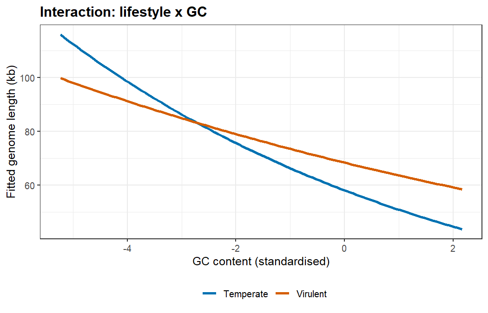
<p class="caption">

Fitted genome length across GC content for Mycobacterium siphoviruses
(Model 4). The two lines have different slopes, which is what the
interaction term measures.
</p>

</div>

``` r
m5 <- lm(log_kb ~ lifestyle + poly(gc_z, 2, raw = TRUE) + host_group + morphotype, data = reg_df)
summary(m5)
```

    ## 
    ## Call:
    ## lm(formula = log_kb ~ lifestyle + poly(gc_z, 2, raw = TRUE) + 
    ##     host_group + morphotype, data = reg_df)
    ## 
    ## Residuals:
    ##      Min       1Q   Median       3Q      Max 
    ## -1.20982 -0.10980  0.02126  0.09501  1.36066 
    ## 
    ## Coefficients:
    ##                             Estimate Std. Error t value Pr(>|t|)    
    ## (Intercept)                 4.314730   0.024410 176.760  < 2e-16 ***
    ## lifestyleVirulent           0.145095   0.010593  13.697  < 2e-16 ***
    ## poly(gc_z, 2, raw = TRUE)1 -0.058971   0.005913  -9.973  < 2e-16 ***
    ## poly(gc_z, 2, raw = TRUE)2  0.020649   0.002634   7.840 5.73e-15 ***
    ## host_groupGordonia          0.388429   0.018840  20.617  < 2e-16 ***
    ## host_groupMicrobacterium   -0.007371   0.020564  -0.358     0.72    
    ## host_groupMycobacterium     0.507907   0.015258  33.287  < 2e-16 ***
    ## host_groupOther            -0.121492   0.030132  -4.032 5.63e-05 ***
    ## host_groupStreptomyces      0.483104   0.023496  20.561  < 2e-16 ***
    ## morphotypePODO             -1.180632   0.055034 -21.453  < 2e-16 ***
    ## morphotypeSIPHO            -0.768263   0.018905 -40.637  < 2e-16 ***
    ## ---
    ## Signif. codes:  0 '***' 0.001 '**' 0.01 '*' 0.05 '.' 0.1 ' ' 1
    ## 
    ## Residual standard error: 0.2657 on 4072 degrees of freedom
    ## Multiple R-squared:  0.5526, Adjusted R-squared:  0.5515 
    ## F-statistic:   503 on 10 and 4072 DF,  p-value: < 2.2e-16

``` r
anova(m3, m5)
```

    ## Analysis of Variance Table
    ## 
    ## Model 1: log_kb ~ lifestyle + gc_z + host_group + morphotype
    ## Model 2: log_kb ~ lifestyle + poly(gc_z, 2, raw = TRUE) + host_group + 
    ##     morphotype
    ##   Res.Df    RSS Df Sum of Sq     F    Pr(>F)    
    ## 1   4073 291.73                                 
    ## 2   4072 287.39  1    4.3377 61.46 5.726e-15 ***
    ## ---
    ## Signif. codes:  0 '***' 0.001 '**' 0.01 '*' 0.05 '.' 0.1 ' ' 1

``` r
b1 <- coef(m5)[["poly(gc_z, 2, raw = TRUE)1"]]
b2 <- coef(m5)[["poly(gc_z, 2, raw = TRUE)2"]]
turnpoint_z  <- -b1 / (2 * b2)
turnpoint_gc <- turnpoint_z * sd(reg_df$gc_percent) + mean(reg_df$gc_percent)
c(turning_point_z = turnpoint_z, turning_point_gc_percent = turnpoint_gc)
```

    ##          turning_point_z turning_point_gc_percent 
    ##                 1.427924                69.574808

The interaction is significant (p = 1e-07): genome size falls with GC
faster in temperate phages (slope -0.132) than in virulent phages (slope
-0.072). The quadratic term is also significant (p = 5.7e-15). Its
turning point is at GC ≈ 69.6%, near the top of the data, so the curve
is a decrease that flattens rather than a U shape. Both terms improve
the adjusted R² by less than one percentage point.

## 3.4 Model comparison and diagnostics

``` r
reg_models <- list("M1 lifestyle" = m1, "M2 GC" = m2, "M3 multiple" = m3,
                   "M4 interaction" = m4, "M5 quadratic" = m5)
reg_table <- data.frame(
  Model  = names(reg_models),
  Adj_R2 = sapply(reg_models, function(m) summary(m)$adj.r.squared),
  AIC    = sapply(reg_models, AIC),
  BIC    = sapply(reg_models, BIC),
  row.names = NULL
)
write.csv(reg_table, "output/regression_models.csv", row.names = FALSE)
knitr::kable(reg_table, digits = 3, caption = "Regression models for log genome length")
```

| Model          | Adj_R2 |      AIC |      BIC |
|:---------------|-------:|---------:|---------:|
| M1 lifestyle   |  0.022 | 3948.962 | 3967.906 |
| M2 GC          |  0.017 | 3969.050 | 3987.994 |
| M3 multiple    |  0.545 |  834.957 |  904.418 |
| M4 interaction |  0.548 |  808.524 |  884.299 |
| M5 quadratic   |  0.552 |  775.791 |  851.566 |

Regression models for log genome length

``` r
par(mfrow = c(2, 2))
plot(m3)
```

<div class="figure" style="text-align: center">

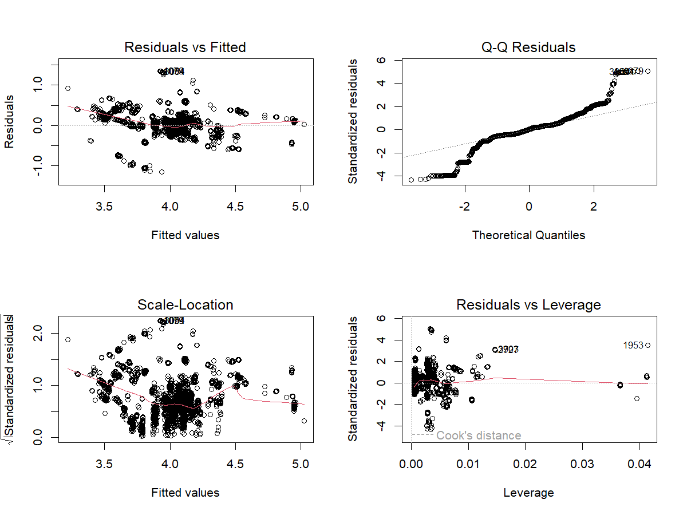
<p class="caption">

Residual diagnostics for Model 3. The stripes and the stepped Q-Q plot
come from groups of almost identical genomes.
</p>

</div>

``` r
par(mfrow = c(1, 1))
```

AIC and BIC prefer Model 5. The diagnostic plots show a problem:
residuals form vertical stripes and the Q-Q plot has steps and heavy
tails. Groups of almost identical genomes have almost identical
residuals. The observations are not independent, so the standard errors
above are too small.

## 3.5 One value per cluster

PhagesDB clusters contain closely related phages. To remove the
dependence, we repeat the lifestyle comparison with one value per
cluster (the cluster mean).

``` r
cluster_means <- reg_df %>%
  group_by(cluster_id, lifestyle) %>%
  summarise(mean_log_kb = mean(log_kb), n_phages = n(), .groups = "drop")

table(cluster_means$lifestyle)
```

    ## 
    ## Temperate  Virulent 
    ##        46        58

``` r
cl_test <- t.test(mean_log_kb ~ lifestyle, data = cluster_means)
cl_test
```

    ## 
    ##  Welch Two Sample t-test
    ## 
    ## data:  mean_log_kb by lifestyle
    ## t = -1.597, df = 101.23, p-value = 0.1134
    ## alternative hypothesis: true difference in means between group Temperate and group Virulent is not equal to 0
    ## 95 percent confidence interval:
    ##  -0.33409023  0.03608059
    ## sample estimates:
    ## mean in group Temperate  mean in group Virulent 
    ##                3.953866                4.102871

With 104 clusters instead of 4083 phages, the difference is similar in
size (virulent clusters are 16% larger), but the p-value goes from
\<2e-16 to **0.11**. The strong significance in Model 1 came from
counting near-copies of the same genome many times. Virulent phages tend
to have larger genomes, but the evidence is weak once this is taken into
account. Section 6 shows the same problem for classification.

# 4. Classical classification

The response is lifestyle, with Temperate as the positive class. As in
Phase II, logistic regression, LDA and QDA use the same four numeric
predictors: genome length, GC content, ORFs per kb and tRNA count.

We report five measures. **Accuracy** is the share of phages classified
correctly. **Sensitivity** is the share of temperate phages found, and
**specificity** the share of virulent phages found. **Balanced
accuracy** is the average of sensitivity and specificity, so both
classes count equally even when one class is larger. **AUC** measures
how well the predicted probabilities rank temperate phages above
virulent ones (0.5 = chance, 1 = perfect).

``` r
class_vars <- c("genome_kb", "gc_percent", "orfs_per_kb", "t_rnas")

class_df <- labeled_df %>%
  select(lifestyle, all_of(class_vars)) %>%
  mutate(temperate01 = as.integer(lifestyle == "Temperate"))

train <- class_df[train_index, ]
test  <- class_df[-train_index, ]

form_glm <- temperate01 ~ genome_kb + gc_percent + orfs_per_kb + t_rnas
form_da  <- lifestyle   ~ genome_kb + gc_percent + orfs_per_kb + t_rnas

measure_table <- function(conf) {
  c(Accuracy          = unname(conf$overall["Accuracy"]),
    Sensitivity       = unname(conf$byClass["Sensitivity"]),
    Specificity       = unname(conf$byClass["Specificity"]),
    Balanced_Accuracy = unname(conf$byClass["Balanced Accuracy"]))
}
```

## 4.1 Logistic regression

``` r
glm_fit <- glm(form_glm, data = train, family = binomial)
summary(glm_fit)
```

    ## 
    ## Call:
    ## glm(formula = form_glm, family = binomial, data = train)
    ## 
    ## Coefficients:
    ##               Estimate Std. Error z value Pr(>|z|)    
    ## (Intercept) -26.277173   1.343669 -19.556   <2e-16 ***
    ## genome_kb    -0.030655   0.003609  -8.493   <2e-16 ***
    ## gc_percent    0.152179   0.014935  10.190   <2e-16 ***
    ## orfs_per_kb  11.555699   0.426376  27.102   <2e-16 ***
    ## t_rnas        0.011481   0.012029   0.954     0.34    
    ## ---
    ## Signif. codes:  0 '***' 0.001 '**' 0.01 '*' 0.05 '.' 0.1 ' ' 1
    ## 
    ## (Dispersion parameter for binomial family taken to be 1)
    ## 
    ##     Null deviance: 3932.5  on 2858  degrees of freedom
    ## Residual deviance: 2357.8  on 2854  degrees of freedom
    ## AIC: 2367.8
    ## 
    ## Number of Fisher Scoring iterations: 5

``` r
# Odds ratios per 1 SD increase, so the predictors can be compared
sds <- sapply(train[, class_vars], sd)
or_table <- data.frame(
  SD       = sds,
  OR_perSD = exp(coef(glm_fit)[class_vars] * sds),
  CI_low   = exp(confint.default(glm_fit)[class_vars, 1] * sds),
  CI_high  = exp(confint.default(glm_fit)[class_vars, 2] * sds)
)
knitr::kable(or_table, digits = 3, caption = "Odds ratios of being temperate per 1 SD increase")
```

|             |     SD | OR_perSD | CI_low | CI_high |
|:------------|-------:|---------:|-------:|--------:|
| genome_kb   | 28.863 |    0.413 |  0.337 |   0.506 |
| gc_percent  |  4.234 |    1.905 |  1.683 |   2.156 |
| orfs_per_kb |  0.176 |    7.663 |  6.614 |   8.879 |
| t_rnas      |  8.860 |    1.107 |  0.898 |   1.364 |

Odds ratios of being temperate per 1 SD increase

``` r
glm_probs <- predict(glm_fit, newdata = test, type = "response")
glm_pred  <- factor(ifelse(glm_probs > 0.5, "Temperate", "Virulent"), levels = levels(test$lifestyle))
cm_glm    <- confusionMatrix(glm_pred, test$lifestyle, positive = "Temperate")
cm_glm
```

    ## Confusion Matrix and Statistics
    ## 
    ##            Reference
    ## Prediction  Temperate Virulent
    ##   Temperate       596      105
    ##   Virulent         80      443
    ##                                           
    ##                Accuracy : 0.8489          
    ##                  95% CI : (0.8275, 0.8685)
    ##     No Information Rate : 0.5523          
    ##     P-Value [Acc > NIR] : < 2e-16         
    ##                                           
    ##                   Kappa : 0.693           
    ##                                           
    ##  Mcnemar's Test P-Value : 0.07765         
    ##                                           
    ##             Sensitivity : 0.8817          
    ##             Specificity : 0.8084          
    ##          Pos Pred Value : 0.8502          
    ##          Neg Pred Value : 0.8470          
    ##              Prevalence : 0.5523          
    ##          Detection Rate : 0.4869          
    ##    Detection Prevalence : 0.5727          
    ##       Balanced Accuracy : 0.8450          
    ##                                           
    ##        'Positive' Class : Temperate       
    ## 

``` r
roc_glm <- roc(test$lifestyle, glm_probs, levels = c("Virulent", "Temperate"), quiet = TRUE)
auc(roc_glm)
```

    ## Area under the curve: 0.8876

Coding density is the strongest marker of a temperate phage (OR = 7.663
per SD), followed by GC content (OR = 1.905). Longer genomes lower the
odds of being temperate (OR = 0.413). tRNA count is not significant once
the other variables are included. On the test set, accuracy is 0.849 and
AUC is 0.888. The classes are almost balanced (55/45), so the 0.5
threshold gives similar sensitivity and specificity.

## 4.2 LDA and QDA

``` r
lda_fit <- lda(form_da, data = train)
lda_fit
```

    ## Call:
    ## lda(form_da, data = train)
    ## 
    ## Prior probabilities of groups:
    ## Temperate  Virulent 
    ## 0.5519412 0.4480588 
    ## 
    ## Group means:
    ##           genome_kb gc_percent orfs_per_kb   t_rnas
    ## Temperate  56.08398   63.79556    1.719835 1.393536
    ## Virulent   71.37323   63.02717    1.512725 5.683060
    ## 
    ## Coefficients of linear discriminants:
    ##                     LD1
    ## genome_kb    0.01960918
    ## gc_percent  -0.09843503
    ## orfs_per_kb -7.19258675
    ## t_rnas      -0.01613706

``` r
lda_out   <- predict(lda_fit, newdata = test)
lda_probs <- lda_out$posterior[, "Temperate"]
cm_lda    <- confusionMatrix(lda_out$class, test$lifestyle, positive = "Temperate")
roc_lda   <- roc(test$lifestyle, lda_probs, levels = c("Virulent", "Temperate"), quiet = TRUE)
```

``` r
qda_fit   <- qda(form_da, data = train)
qda_out   <- predict(qda_fit, newdata = test)
qda_probs <- qda_out$posterior[, "Temperate"]
cm_qda    <- confusionMatrix(qda_out$class, test$lifestyle, positive = "Temperate")
roc_qda   <- roc(test$lifestyle, qda_probs, levels = c("Virulent", "Temperate"), quiet = TRUE)
```

``` r
class_perf <- data.frame(
  Model = c("Logistic", "LDA", "QDA"),
  rbind(measure_table(cm_glm), measure_table(cm_lda), measure_table(cm_qda)),
  AUC = c(auc(roc_glm), auc(roc_lda), auc(roc_qda))
)
knitr::kable(class_perf, digits = 3, caption = "Test-set performance of the classical classifiers")
```

| Model    | Accuracy | Sensitivity | Specificity | Balanced_Accuracy |   AUC |
|:---------|---------:|------------:|------------:|------------------:|------:|
| Logistic |    0.849 |       0.882 |       0.808 |             0.845 | 0.888 |
| LDA      |    0.853 |       0.891 |       0.807 |             0.849 | 0.887 |
| QDA      |    0.824 |       0.916 |       0.710 |             0.813 | 0.905 |

Test-set performance of the classical classifiers

``` r
ggroc(list(Logistic = roc_glm, LDA = roc_lda, QDA = roc_qda), legacy.axes = TRUE, linewidth = 0.9) +
  geom_abline(slope = 1, intercept = 0, linetype = "dotted") +
  labs(title = "ROC curves on the test set", x = "1 - Specificity", y = "Sensitivity", colour = "")
```

<div class="figure" style="text-align: center">

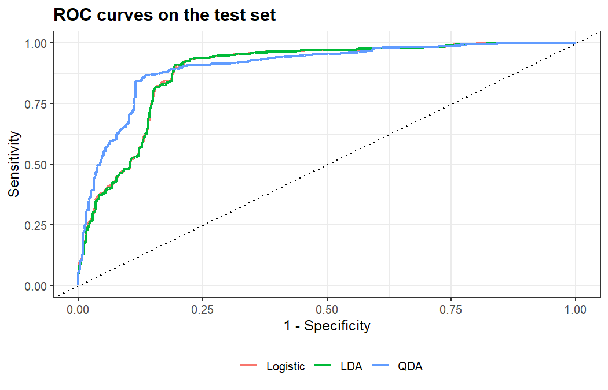
<p class="caption">

ROC curves of the three classical classifiers on the test set. Logistic
regression and LDA almost overlap. The dotted diagonal is a classifier
that guesses at random.
</p>

</div>

LDA gives almost the same result as logistic regression. QDA has the
best AUC (0.905) but the lowest accuracy, because at 0.5 it labels too
many virulent phages as temperate (specificity 0.710). LDA and QDA
assume normal predictors, which is not true here (tRNA counts are mostly
zero), but they still perform reasonably.

## 4.3 10-fold cross-validation

``` r
set.seed(SEED)
ctrl <- trainControl(method = "cv", number = 10, classProbs = TRUE, summaryFunction = twoClassSummary)

cv_glm <- train(form_da, data = train, method = "glm", family = binomial, trControl = ctrl, metric = "ROC")
cv_lda <- train(form_da, data = train, method = "lda", trControl = ctrl, metric = "ROC")
cv_qda <- train(form_da, data = train, method = "qda", trControl = ctrl, metric = "ROC")

cv_df <- data.frame(
  Model     = c("Logistic", "LDA", "QDA"),
  CV_AUC    = c(cv_glm$results$ROC, cv_lda$results$ROC, cv_qda$results$ROC),
  CV_AUC_SD = c(cv_glm$results$ROCSD, cv_lda$results$ROCSD, cv_qda$results$ROCSD),
  Test_AUC  = class_perf$AUC
)
knitr::kable(cv_df, digits = 3, caption = "10-fold cross-validated AUC (training set) vs test AUC")
```

| Model    | CV_AUC | CV_AUC_SD | Test_AUC |
|:---------|-------:|----------:|---------:|
| Logistic |  0.889 |     0.020 |    0.888 |
| LDA      |  0.889 |     0.012 |    0.887 |
| QDA      |  0.915 |     0.015 |    0.905 |

10-fold cross-validated AUC (training set) vs test AUC

The cross-validated AUCs are close to the test AUCs, so these simple
models are not overfitting.

## 4.4 Bootstrap

Each bootstrap sample is used to fit the logistic model, which is then
scored on the phages that were not drawn (out-of-bag).

``` r
oob_error <- function(data, indices) {
  fit      <- glm(form_glm, data = data[indices, ], family = binomial)
  oob_rows <- setdiff(seq_len(nrow(data)), indices)
  # boot() also calls this once on the original data, where there are no out-of-bag rows
  if (length(oob_rows) == 0) oob_rows <- seq_len(nrow(data))
  probs <- predict(fit, newdata = data[oob_rows, ], type = "response")
  mean(ifelse(probs > 0.5, 1, 0) != data$temperate01[oob_rows])
}

set.seed(SEED)
boot_res <- boot(data = train, statistic = oob_error, R = 200)
data.frame(Bootstrap_Error = mean(boot_res$t), Std_Error = sd(boot_res$t),
           CI_2.5 = quantile(boot_res$t, 0.025), CI_97.5 = quantile(boot_res$t, 0.975), row.names = NULL)
```

    ##   Bootstrap_Error Std_Error    CI_2.5   CI_97.5
    ## 1       0.1562383  0.010318 0.1383821 0.1754726

The bootstrap error is 0.156 (SE 0.010), close to the test error of
0.151.

## 4.5 Variable selection

Here all eight numeric features are candidates. Selection uses the
training set only.

``` r
train_sel <- labeled_df[train_index, ] %>% select(lifestyle, all_of(numeric_vars))
test_sel  <- labeled_df[-train_index, ] %>% select(lifestyle, all_of(numeric_vars))

# bestglm needs the predictors first and a 0/1 response called y last
Xy <- data.frame(train_sel[, numeric_vars], y = as.integer(train_sel$lifestyle == "Temperate"))
best_bic <- bestglm(Xy = Xy, family = binomial, IC = "BIC")
best_bic$Subsets
```

    ##    Intercept genome_kb gc_percent  orfs t_rnas tm_rnas orfs_per_kb t_rnas_per_kb tm_rnas_per_kb logLikelihood      BIC
    ## 0       TRUE     FALSE      FALSE FALSE  FALSE   FALSE       FALSE         FALSE          FALSE     -1966.253 3932.507
    ## 1       TRUE     FALSE      FALSE FALSE  FALSE   FALSE        TRUE         FALSE          FALSE     -1376.243 2760.444
    ## 2       TRUE     FALSE      FALSE  TRUE  FALSE   FALSE        TRUE         FALSE          FALSE     -1243.890 2503.696
    ## 3       TRUE     FALSE       TRUE  TRUE  FALSE   FALSE        TRUE         FALSE          FALSE     -1179.189 2382.252
    ## 4       TRUE     FALSE       TRUE  TRUE  FALSE   FALSE        TRUE          TRUE          FALSE     -1171.122 2374.077
    ## 5       TRUE     FALSE       TRUE  TRUE  FALSE    TRUE        TRUE          TRUE          FALSE     -1156.551 2352.893
    ## 6*      TRUE     FALSE       TRUE  TRUE  FALSE    TRUE        TRUE          TRUE           TRUE     -1151.639 2351.027
    ## 7       TRUE     FALSE       TRUE  TRUE   TRUE    TRUE        TRUE          TRUE           TRUE     -1151.196 2358.101
    ## 8       TRUE      TRUE       TRUE  TRUE   TRUE    TRUE        TRUE          TRUE           TRUE     -1151.162 2365.989

``` r
step_train <- train_sel %>% mutate(temperate01 = as.integer(lifestyle == "Temperate")) %>% select(-lifestyle)
glm_null     <- glm(temperate01 ~ 1, data = step_train, family = binomial)
glm_full_sel <- glm(temperate01 ~ ., data = step_train, family = binomial)

step_forward  <- stepAIC(glm_null, scope = formula(glm_full_sel), direction = "forward", trace = FALSE)
step_backward <- stepAIC(glm_full_sel, direction = "backward", trace = FALSE)
formula(step_forward)
```

    ## temperate01 ~ orfs_per_kb + orfs + gc_percent + t_rnas_per_kb + 
    ##     tm_rnas + tm_rnas_per_kb

``` r
formula(step_backward)
```

    ## temperate01 ~ gc_percent + orfs + tm_rnas + orfs_per_kb + t_rnas_per_kb + 
    ##     tm_rnas_per_kb

``` r
evaluate_glm <- function(fit, newdata, name) {
  probs <- predict(fit, newdata = newdata, type = "response")
  pred  <- factor(ifelse(probs > 0.5, "Temperate", "Virulent"), levels = c("Temperate", "Virulent"))
  cm    <- confusionMatrix(pred, newdata$lifestyle, positive = "Temperate")
  data.frame(Model = name, N_predictors = length(coef(fit)) - 1, t(measure_table(cm)),
             AUC = as.numeric(auc(roc(newdata$lifestyle, probs, levels = c("Virulent", "Temperate"), quiet = TRUE))))
}

sel_perf <- rbind(
  evaluate_glm(glm_full_sel, test_sel, "Full (8 predictors)"),
  evaluate_glm(best_bic$BestModel, test_sel, "Best subset (BIC)"),
  evaluate_glm(step_forward, test_sel, "Forward stepwise (AIC)"),
  evaluate_glm(step_backward, test_sel, "Backward stepwise (AIC)")
)
knitr::kable(sel_perf, digits = 3, caption = "Selected logistic models on the test set")
```

| Model | N_predictors | Accuracy | Sensitivity | Specificity | Balanced_Accuracy | AUC |
|:---|---:|---:|---:|---:|---:|---:|
| Full (8 predictors) | 8 | 0.865 | 0.892 | 0.832 | 0.862 | 0.891 |
| Best subset (BIC) | 6 | 0.864 | 0.892 | 0.830 | 0.861 | 0.891 |
| Forward stepwise (AIC) | 6 | 0.864 | 0.892 | 0.830 | 0.861 | 0.891 |
| Backward stepwise (AIC) | 6 | 0.864 | 0.892 | 0.830 | 0.861 | 0.891 |

Selected logistic models on the test set

BIC and both stepwise searches choose the same 6 variables: gc_percent,
orfs, tm_rnas, orfs_per_kb, t_rnas_per_kb, tm_rnas_per_kb. Genome length
and tRNA count are dropped because the ORF count and the densities
already contain that information. The smaller model performs the same as
the full model on the test set. The tmRNA coefficients are unstable
because tmRNA genes are rare, so we do not interpret them.

## 4.6 Decision threshold

The Youden threshold is chosen on the training data and then applied to
the test set.

``` r
train_probs <- predict(glm_fit, newdata = train, type = "response")
roc_train   <- roc(train$lifestyle, train_probs, levels = c("Virulent", "Temperate"), quiet = TRUE)
optimal <- coords(roc_train, x = "best", best.method = "youden",
                  ret = c("threshold", "sensitivity", "specificity"), transpose = FALSE)
opt_thr <- as.numeric(optimal$threshold[1])

youden_pred <- factor(ifelse(glm_probs > opt_thr, "Temperate", "Virulent"), levels = c("Temperate", "Virulent"))
cm_youden   <- confusionMatrix(youden_pred, test$lifestyle, positive = "Temperate")
knitr::kable(rbind("Threshold 0.5" = measure_table(cm_glm), "Youden threshold" = measure_table(cm_youden)),
             digits = 3, caption = "Logistic regression on the test set at two thresholds")
```

|                  | Accuracy | Sensitivity | Specificity | Balanced_Accuracy |
|:-----------------|---------:|------------:|------------:|------------------:|
| Threshold 0.5    |    0.849 |       0.882 |       0.808 |             0.845 |
| Youden threshold |    0.863 |       0.926 |       0.785 |             0.855 |

Logistic regression on the test set at two thresholds

The Youden threshold is 0.419, close to 0.5 because the classes are
balanced. It raises sensitivity from 0.882 to 0.926 with a small loss in
specificity. Unlike in Phase II, where only 10% of the cases were
positive, the threshold makes little difference here.

# 5. Trees and ensembles

Trees can also use the categorical features: morphotype, DNA end type
and host genus.

``` r
tree_data <- labeled_df %>%
  select(lifestyle, genome_kb, gc_percent, orfs, t_rnas, tm_rnas,
         orfs_per_kb, t_rnas_per_kb, tm_rnas_per_kb,
         morphotype, end_type, host_genus)
train_df <- tree_data[train_index, ]
test_df  <- tree_data[-train_index, ]
```

## 5.1 Decision tree and pruning

We grow a large tree (cp = 0) and prune it with 10-fold
cross-validation, using the 1-SE rule (the smallest tree whose error is
within one standard error of the minimum).

``` r
set.seed(SEED)
tree_fit <- rpart(lifestyle ~ ., data = train_df, method = "class",
                  control = rpart.control(cp = 0, minsplit = 5, xval = 10))

cp_table <- tree_fit$cptable
best_row <- which.min(cp_table[, "xerror"])
cp_1se   <- cp_table[which(cp_table[, "xerror"] <= cp_table[best_row, "xerror"] + cp_table[best_row, "xstd"])[1], "CP"]
pruned_tree <- prune(tree_fit, cp = cp_1se)

rpart.plot(prune(tree_fit, cp = 0.01), main = "Top of the tree (cp = 0.01)", cex = 0.8,
           box.palette = list("Blues", "Oranges"))
```

<div class="figure" style="text-align: center">

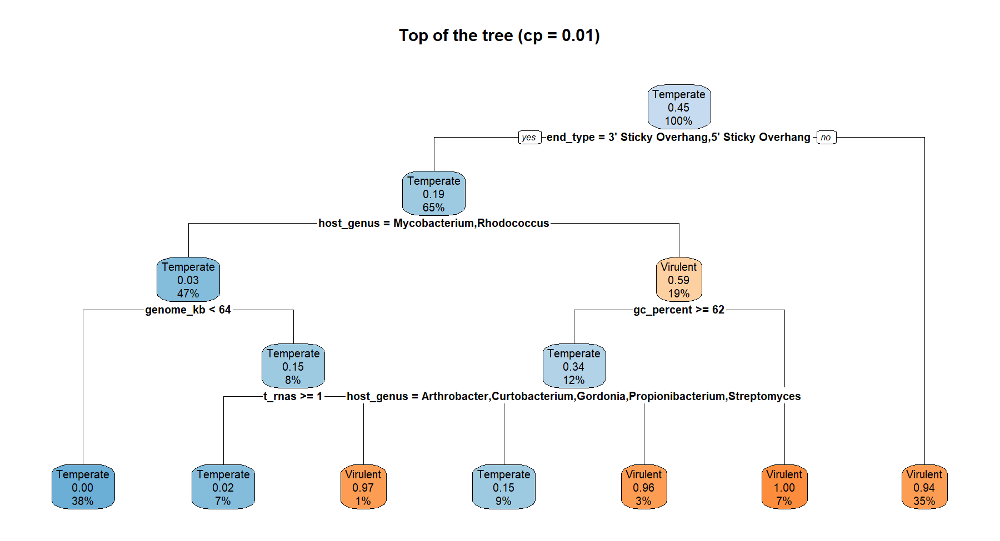
<p class="caption">

The first splits of the tree (blue = temperate, orange = virulent). Each
box shows the predicted class, the share of virulent phages and the
share of all phages in that node.
</p>

</div>

``` r
tree_pred <- predict(pruned_tree, newdata = test_df, type = "class")
cm_tree   <- confusionMatrix(tree_pred, test_df$lifestyle, positive = "Temperate")

tree_list <- list("Full tree (cp = 0)" = tree_fit, "Pruned tree (1-SE rule)" = pruned_tree)
overfit_df <- data.frame(
  Model  = names(tree_list),
  Leaves = sapply(tree_list, function(t) sum(t$frame$var == "<leaf>")),
  Train_Accuracy = sapply(tree_list, function(t) mean(predict(t, train_df, type = "class") == train_df$lifestyle)),
  Test_Accuracy  = sapply(tree_list, function(t) mean(predict(t, test_df, type = "class") == test_df$lifestyle)),
  row.names = NULL
)
knitr::kable(overfit_df, digits = 3, caption = "Train vs test accuracy before and after pruning")
```

| Model                   | Leaves | Train_Accuracy | Test_Accuracy |
|:------------------------|-------:|---------------:|--------------:|
| Full tree (cp = 0)      |     37 |          0.997 |         0.984 |
| Pruned tree (1-SE rule) |     24 |          0.992 |         0.983 |

Train vs test accuracy before and after pruning

``` r
plotcp(tree_fit, main = "Cross-validated error vs cp")
```

<div class="figure" style="text-align: center">

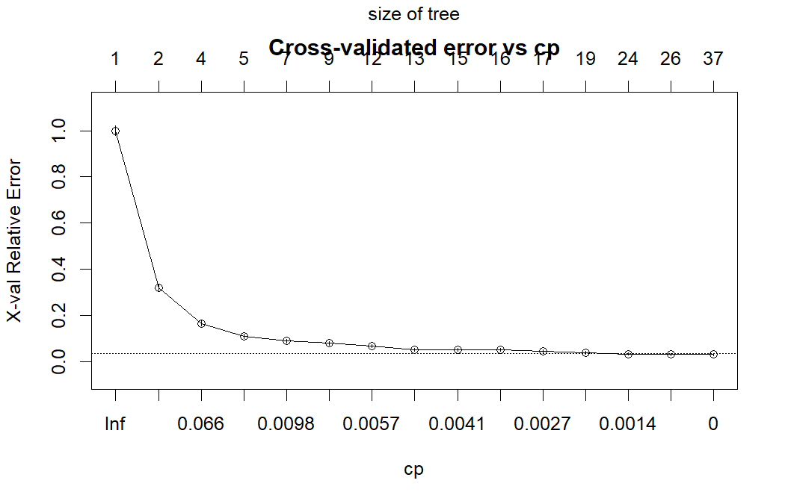
<p class="caption">

Cross-validated error against the complexity parameter cp. The error
falls quickly with the first splits and then flattens, so a smaller tree
loses little.
</p>

</div>

Pruning reduces the tree from 37 to 24 leaves with almost no change in
test accuracy (0.983). The first split is on DNA end type. Phages with
sticky overhangs go to a mostly temperate branch and the others to a
mostly virulent branch. Host genus, GC content and genome length refine
the leaves.

## 5.2 Bagging, random forest and boosting

``` r
p <- ncol(train_df) - 1

set.seed(SEED)
bag_fit <- randomForest(lifestyle ~ ., data = train_df, mtry = p, ntree = 500)
set.seed(SEED)
bag_no_host <- randomForest(lifestyle ~ ., data = select(train_df, -host_genus), mtry = p - 1, ntree = 500)
set.seed(SEED)
rf_fit  <- randomForest(lifestyle ~ ., data = train_df, mtry = floor(sqrt(p)), ntree = 500)

train_boost <- train_df %>% mutate(y = as.integer(lifestyle == "Temperate")) %>% select(-lifestyle)
test_boost  <- test_df  %>% mutate(y = as.integer(lifestyle == "Temperate")) %>% select(-lifestyle)
set.seed(SEED)
boost_fit <- gbm(y ~ ., data = train_boost, distribution = "bernoulli",
                 n.trees = 2000, interaction.depth = 3, shrinkage = 0.01,
                 cv.folds = 5, n.minobsinnode = 10, verbose = FALSE)
best_iter  <- gbm.perf(boost_fit, method = "cv", plot.it = FALSE)
boost_prob <- predict(boost_fit, newdata = test_boost, n.trees = best_iter, type = "response")
boost_pred <- factor(ifelse(boost_prob > 0.5, "Temperate", "Virulent"), levels = c("Temperate", "Virulent"))

cm_bag     <- confusionMatrix(predict(bag_fit, test_df), test_df$lifestyle, positive = "Temperate")
cm_bag_nh  <- confusionMatrix(predict(bag_no_host, test_df), test_df$lifestyle, positive = "Temperate")
cm_rf      <- confusionMatrix(predict(rf_fit, test_df), test_df$lifestyle, positive = "Temperate")
cm_boost   <- confusionMatrix(boost_pred, test_df$lifestyle, positive = "Temperate")

oob_df <- data.frame(
  trees     = rep(1:500, 2),
  model     = rep(c("Bagging", "Random forest"), each = 500),
  oob_error = c(bag_fit$err.rate[, "OOB"], rf_fit$err.rate[, "OOB"])
)
ggplot(oob_df, aes(x = trees, y = oob_error, colour = model)) +
  geom_line() +
  scale_colour_manual(values = c("Bagging" = "grey40", "Random forest" = "#009E73")) +
  labs(title = "OOB error vs number of trees", x = "Number of trees", y = "OOB error rate", colour = "")
```

<div class="figure" style="text-align: center">

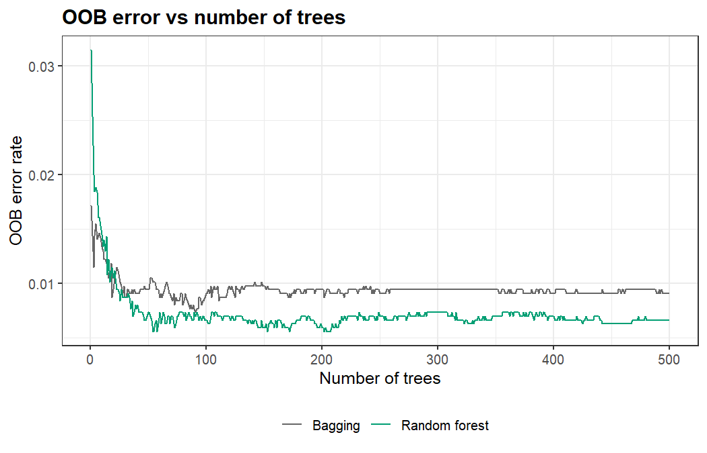
<p class="caption">

Out-of-bag error as trees are added. Both curves flatten, so 500 trees
are enough.
</p>

</div>

``` r
rf_importance <- sort(importance(rf_fit)[, "MeanDecreaseGini"], decreasing = TRUE)
ggplot(data.frame(feature = names(rf_importance), importance = rf_importance),
       aes(x = reorder(feature, importance), y = importance)) +
  geom_col(fill = "grey50") +
  coord_flip() +
  labs(title = "Random forest variable importance", x = "", y = "Mean decrease in Gini impurity")
```

<div class="figure" style="text-align: center">

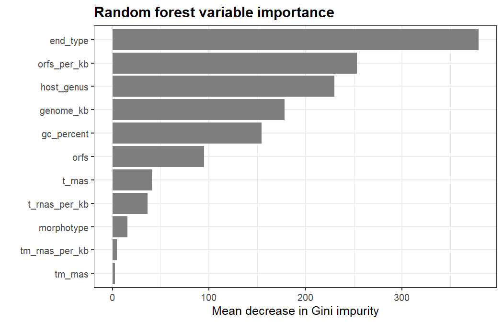
<p class="caption">

Random forest variable importance on the random split (mean decrease in
Gini impurity).
</p>

</div>

## 5.3 All models on the random split

``` r
perf_df <- data.frame(
  Model = c("Logistic (4 numeric)", "LDA (4 numeric)", "QDA (4 numeric)",
            "Pruned tree", "Bagging", "Bagging (no host)", "Random forest", "Boosting"),
  rbind(measure_table(cm_glm), measure_table(cm_lda), measure_table(cm_qda),
        measure_table(cm_tree), measure_table(cm_bag), measure_table(cm_bag_nh),
        measure_table(cm_rf), measure_table(cm_boost))
)
write.csv(perf_df, "output/model_comparison_random_split.csv", row.names = FALSE)
knitr::kable(perf_df, digits = 3, caption = "Test-set performance, random 70/30 split")
```

| Model                | Accuracy | Sensitivity | Specificity | Balanced_Accuracy |
|:---------------------|---------:|------------:|------------:|------------------:|
| Logistic (4 numeric) |    0.849 |       0.882 |       0.808 |             0.845 |
| LDA (4 numeric)      |    0.853 |       0.891 |       0.807 |             0.849 |
| QDA (4 numeric)      |    0.824 |       0.916 |       0.710 |             0.813 |
| Pruned tree          |    0.983 |       0.984 |       0.982 |             0.983 |
| Bagging              |    0.989 |       0.988 |       0.991 |             0.990 |
| Bagging (no host)    |    0.988 |       0.982 |       0.995 |             0.988 |
| Random forest        |    0.993 |       0.991 |       0.996 |             0.994 |
| Boosting             |    0.993 |       0.993 |       0.993 |             0.993 |

Test-set performance, random 70/30 split

The tree-based models are far better than the linear ones: the random
forest reaches 0.993 accuracy and boosting 0.993, against about 0.85 for
logistic regression. The importance plot ranks end_type, orfs_per_kb,
host_genus, genome_kb as the four most important features. Removing host
genus barely changes bagging (0.988). For boosting, cross-validation
picked 2000 iterations, the maximum allowed, so a longer run could gain
a little more.

These accuracies look almost perfect. The next section checks whether
they are real.

# 6. Validation check: are related phages leaking into the test set?

A random split assumes that phages are independent. PhagesDB groups
related phages into clusters, and the check below shows that **every
labelled cluster has only one lifestyle**. In a random split, almost
every test phage has close relatives in the training set. A model can
then do well by recognising the cluster instead of learning what makes a
phage temperate. This is a form of **data leakage**.

This matters for the real use of the model: none of the unlabelled
phages belongs to a labelled cluster.

## 6.1 Cluster structure

``` r
cluster_summary <- labeled_df %>%
  group_by(cluster_id) %>%
  summarise(n_phages = n(), n_lifestyles = n_distinct(lifestyle),
            lifestyle = first(lifestyle), .groups = "drop")

cat("Labelled clusters:", nrow(cluster_summary), "\n")
```

    ## Labelled clusters: 104

``` r
cat("Clusters with both lifestyles:", sum(cluster_summary$n_lifestyles > 1), "\n")
```

    ## Clusters with both lifestyles: 0

``` r
table(cluster_summary$lifestyle)
```

    ## 
    ## Temperate  Virulent 
    ##        46        58

``` r
summary(cluster_summary$n_phages)
```

    ##    Min. 1st Qu.  Median    Mean 3rd Qu.    Max. 
    ##    1.00    5.00   12.00   39.26   34.25  862.00

``` r
cat("Unlabelled phages in a labelled cluster:",
    sum(unlabeled_df$cluster_id %in% labeled_df$cluster_id), "of", nrow(unlabeled_df), "\n")
```

    ## Unlabelled phages in a labelled cluster: 0 of 237

## 6.2 A baseline with no genome data

This baseline predicts each test phage with the most common lifestyle of
its cluster in the training data. If the cluster is not in the training
data, it predicts the overall majority. It uses no genome feature at
all.

``` r
lookup_predict <- function(train_rows, test_rows) {
  majority  <- names(which.max(table(train_rows$lifestyle)))
  cl_lookup <- train_rows %>% count(cluster_id, lifestyle) %>%
    group_by(cluster_id) %>% slice_max(n, n = 1, with_ties = FALSE) %>% ungroup()
  pred <- as.character(cl_lookup$lifestyle[match(test_rows$cluster_id, cl_lookup$cluster_id)])
  pred[is.na(pred)] <- majority
  factor(pred, levels = c("Temperate", "Virulent"))
}

cm_lookup <- confusionMatrix(lookup_predict(labeled_df[train_index, ], labeled_df[-train_index, ]),
                             labeled_df$lifestyle[-train_index], positive = "Temperate")
measure_table(cm_lookup)
```

    ##          Accuracy       Sensitivity       Specificity Balanced_Accuracy 
    ##         0.9983660         1.0000000         0.9963504         0.9981752

On our random split, the baseline reaches 0.998 accuracy without any
biology. This shows how much a random split rewards simply recognising
the cluster.

## 6.3 Random split vs held-out clusters

We repeat two protocols 10 times. **Random phages**: 30% of phages go to
the test set. **Held-out clusters**: 30% of whole clusters go to the
test set, so no test phage has a relative in the training data.

``` r
evaluate_split <- function(train_rows, test_rows) {
  tr <- train_rows %>% select(all_of(names(tree_data)))
  te <- test_rows  %>% select(all_of(names(tree_data)))

  glm_m <- glm(form_glm, data = mutate(tr, temperate01 = as.integer(lifestyle == "Temperate")), family = binomial)
  glm_p <- factor(ifelse(predict(glm_m, te, type = "response") > 0.5, "Temperate", "Virulent"),
                  levels = c("Temperate", "Virulent"))
  rf_m  <- randomForest(lifestyle ~ ., data = tr, ntree = 300)
  rf_nh <- randomForest(lifestyle ~ ., data = select(tr, -host_genus), ntree = 300)

  preds <- list("Cluster lookup (no genomics)" = lookup_predict(train_rows, test_rows),
                "Logistic (4 numeric)"         = glm_p,
                "Random forest"                = predict(rf_m, te),
                "Random forest (no host)"      = predict(rf_nh, te))
  do.call(rbind, lapply(names(preds), function(m) {
    cm <- confusionMatrix(preds[[m]], te$lifestyle, positive = "Temperate")
    data.frame(model = m, accuracy = unname(cm$overall["Accuracy"]),
               balanced_acc = unname(cm$byClass["Balanced Accuracy"]))
  }))
}

all_clusters <- unique(labeled_df$cluster_id)
holdout_results <- data.frame()

set.seed(SEED)
for (r in 1:N_REPEATS) {
  idx <- createDataPartition(labeled_df$lifestyle, p = 0.7, list = FALSE)
  res_random <- evaluate_split(labeled_df[idx, ], labeled_df[-idx, ])
  res_random$protocol <- "Random phages"

  test_clusters <- sample(all_clusters, size = round(0.3 * length(all_clusters)))
  in_test <- labeled_df$cluster_id %in% test_clusters
  res_cluster <- evaluate_split(labeled_df[!in_test, ], labeled_df[in_test, ])
  res_cluster$protocol <- "Held-out clusters"

  holdout_results <- rbind(holdout_results, cbind(repeat_id = r, rbind(res_random, res_cluster)))
}

holdout_summary <- holdout_results %>%
  group_by(protocol, model) %>%
  summarise(accuracy_mean = mean(accuracy), accuracy_sd = sd(accuracy),
            balanced_acc_mean = mean(balanced_acc), balanced_acc_sd = sd(balanced_acc), .groups = "drop") %>%
  arrange(desc(protocol), desc(balanced_acc_mean))

write.csv(holdout_results, "output/holdout_repeats.csv", row.names = FALSE)
write.csv(holdout_summary, "output/holdout_summary.csv", row.names = FALSE)
knitr::kable(holdout_summary, digits = 3, caption = paste("Mean (SD) over", N_REPEATS, "repeated 70/30 splits"))
```

| protocol | model | accuracy_mean | accuracy_sd | balanced_acc_mean | balanced_acc_sd |
|:---|:---|---:|---:|---:|---:|
| Random phages | Cluster lookup (no genomics) | 0.999 | 0.001 | 0.999 | 0.001 |
| Random phages | Random forest | 0.992 | 0.002 | 0.992 | 0.002 |
| Random phages | Random forest (no host) | 0.988 | 0.004 | 0.988 | 0.004 |
| Random phages | Logistic (4 numeric) | 0.840 | 0.010 | 0.837 | 0.010 |
| Held-out clusters | Random forest | 0.870 | 0.096 | 0.849 | 0.115 |
| Held-out clusters | Random forest (no host) | 0.854 | 0.131 | 0.843 | 0.130 |
| Held-out clusters | Logistic (4 numeric) | 0.719 | 0.143 | 0.710 | 0.142 |
| Held-out clusters | Cluster lookup (no genomics) | 0.415 | 0.181 | 0.500 | 0.000 |

Mean (SD) over 10 repeated 70/30 splits

``` r
plot_df <- holdout_summary %>%
  mutate(model = factor(model, levels = c("Cluster lookup (no genomics)", "Logistic (4 numeric)",
                                          "Random forest (no host)", "Random forest")),
         protocol = factor(protocol, levels = c("Random phages", "Held-out clusters")))

ggplot(plot_df, aes(x = model, y = balanced_acc_mean, fill = protocol)) +
  geom_col(position = position_dodge(width = 0.8), width = 0.75) +
  geom_errorbar(aes(ymin = balanced_acc_mean - balanced_acc_sd,
                    ymax = pmin(1, balanced_acc_mean + balanced_acc_sd)),
                position = position_dodge(width = 0.8), width = 0.25) +
  geom_hline(yintercept = 0.5, linetype = "dashed") +
  coord_flip(ylim = c(0.4, 1)) +
  scale_fill_manual(values = test_cols) +
  labs(title = "Random phages vs held-out clusters",
       x = "", y = "Balanced accuracy (mean +/- SD)", fill = "Test set")
```

<div class="figure" style="text-align: center">

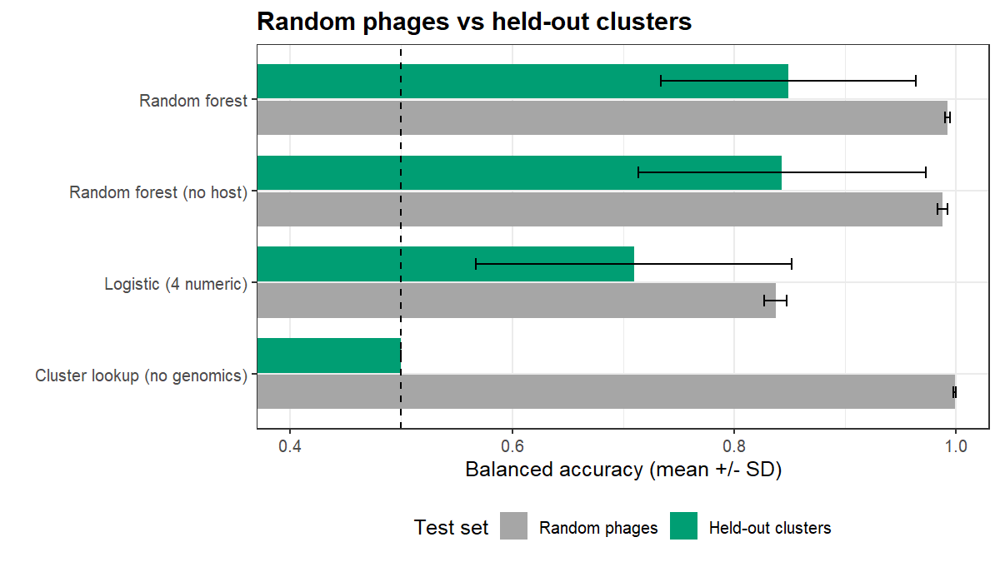
<p class="caption">

Mean balanced accuracy over the repeated splits (error bars show one
standard deviation). The dashed line is chance level (0.5). Every model
loses accuracy when whole clusters are held out, and the no-genomics
baseline falls to chance.
</p>

</div>

- The no-genomics baseline scores 0.999 on random splits and 0.5
  (chance) on held-out clusters.
- The random forest drops from 0.992 to 0.849 balanced accuracy, and its
  variation between repeats grows (SD 0.115).
- Logistic regression drops from 0.837 to 0.710.

So the 99% accuracy of section 5 mostly measures how well a model
recognises known clusters. On new clusters the random forest is still
well above chance, so the genome features do contain real information
about lifestyle.

## 6.4 Grouped 10-fold cross-validation

The repeated splits above use a different test set each time. Grouped
cross-validation gives every labelled phage exactly one prediction made
by a model that never saw its cluster (`caret::groupKFold`). These
out-of-fold predictions are used in the rest of section 6.

``` r
# Random forest under grouped cross-validation. Returns P(Temperate) for every row.
grouped_cv_rf <- function(data, folds, ntree = 300) {
  prob <- rep(NA_real_, nrow(data))
  for (train_rows in folds) {
    test_rows <- setdiff(seq_len(nrow(data)), train_rows)
    fit <- randomForest(lifestyle ~ ., data = data[train_rows, ], ntree = ntree)
    prob[test_rows] <- predict(fit, data[test_rows, ], type = "prob")[, "Temperate"]
  }
  prob
}

balanced_accuracy <- function(truth, prob) {
  pred <- ifelse(prob > 0.5, "Temperate", "Virulent")
  mean(c(mean(pred[truth == "Temperate"] == "Temperate"),
         mean(pred[truth == "Virulent"]  == "Virulent")))
}

set.seed(SEED)
group_folds <- groupKFold(labeled_df$cluster_id, k = 10)   # list of training rows for each fold

set.seed(SEED)
oof <- labeled_df %>% select(phage_name, cluster_id, lifestyle)
oof$prob_rf <- grouped_cv_rf(tree_data, group_folds)

oof$prob_glm <- NA_real_
for (train_rows in group_folds) {
  test_rows <- setdiff(seq_len(nrow(class_df)), train_rows)
  fit <- glm(form_glm, data = class_df[train_rows, ], family = binomial)
  oof$prob_glm[test_rows] <- predict(fit, class_df[test_rows, ], type = "response")
}
oof$correct_rf <- ifelse(oof$prob_rf > 0.5, "Temperate", "Virulent") == oof$lifestyle
write.csv(oof, "output/grouped_cv_predictions.csv", row.names = FALSE)

roc_oof_rf  <- roc(oof$lifestyle, oof$prob_rf,  levels = c("Virulent", "Temperate"), quiet = TRUE)
roc_oof_glm <- roc(oof$lifestyle, oof$prob_glm, levels = c("Virulent", "Temperate"), quiet = TRUE)

grouped_cv_table <- data.frame(
  Model = c("Logistic (4 numeric)", "Random forest"),
  Accuracy = c(mean((oof$prob_glm > 0.5) == (oof$lifestyle == "Temperate")), mean(oof$correct_rf)),
  Balanced_Accuracy = c(balanced_accuracy(oof$lifestyle, oof$prob_glm), balanced_accuracy(oof$lifestyle, oof$prob_rf)),
  AUC = c(auc(roc_oof_glm), auc(roc_oof_rf))
)
knitr::kable(grouped_cv_table, digits = 3, caption = "Grouped 10-fold cross-validation (whole clusters held out)")
```

| Model                | Accuracy | Balanced_Accuracy |   AUC |
|:---------------------|---------:|------------------:|------:|
| Logistic (4 numeric) |    0.782 |             0.774 | 0.793 |
| Random forest        |    0.937 |             0.936 | 0.974 |

Grouped 10-fold cross-validation (whole clusters held out)

``` r
ggroc(list("Random forest" = roc_oof_rf, "Logistic (4 numeric)" = roc_oof_glm), legacy.axes = TRUE, linewidth = 0.9) +
  geom_abline(slope = 1, intercept = 0, linetype = "dotted") +
  scale_colour_manual(values = c("#009E73", "grey40")) +
  labs(title = "ROC under grouped cross-validation", x = "1 - Specificity", y = "Sensitivity", colour = "")
```

<div class="figure" style="text-align: center">

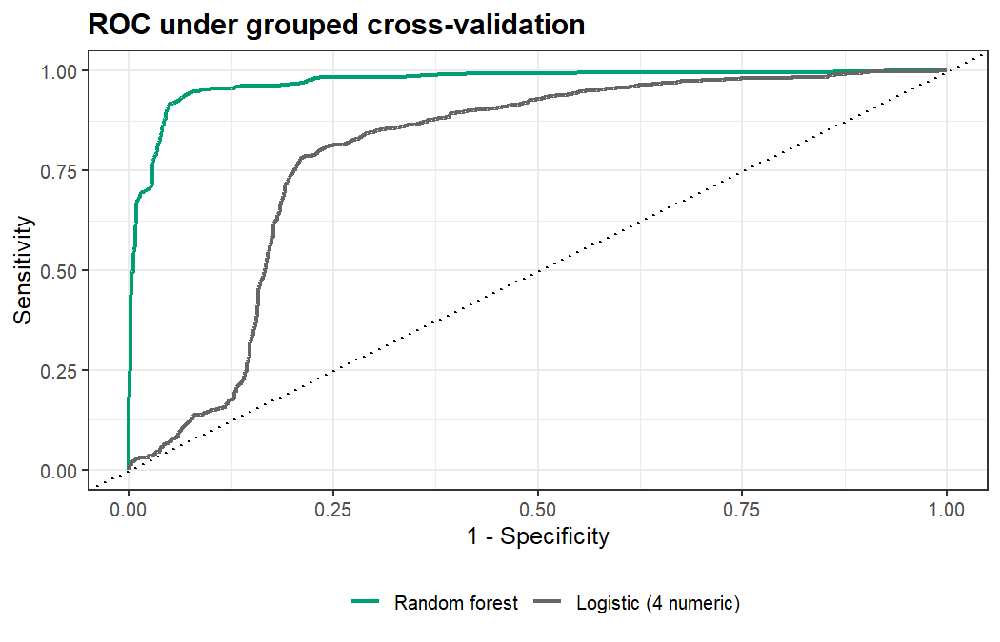
<p class="caption">

ROC curves from the grouped cross-validation predictions, where every
phage was predicted by a model that never saw its cluster.
</p>

</div>

With whole clusters held out, the random forest reaches 0.937 accuracy
and an AUC of 0.974. This is lower than the 99% of the random split, but
higher than the held-out-cluster splits in 6.3. There are two reasons.
Each grouped fold trains on 90% of the clusters instead of 70%, so the
model sees more variety. And pooling all predictions gives large
clusters more weight, and large clusters are easier (see 6.5). Logistic
regression drops to 0.782: the four numeric features alone do not
transfer well to new clusters.

## 6.5 Accuracy per cluster

The accuracy above counts every phage once, so large clusters weigh
more. Here every cluster counts once, and we look at accuracy by cluster
size. This matters because most unlabelled phages are in small clusters.

``` r
per_cluster <- oof %>%
  group_by(cluster_id, lifestyle) %>%
  summarise(n_phages = n(), accuracy = mean(correct_rf), .groups = "drop") %>%
  mutate(size_group = cut(n_phages, breaks = c(0, 3, 20, Inf), labels = c("1-3 phages", "4-20 phages", ">20 phages")))
write.csv(per_cluster, "output/grouped_cv_per_cluster.csv", row.names = FALSE)

data.frame(
  Weighting = c("Every phage counts once", "Every cluster counts once"),
  Accuracy  = c(mean(oof$correct_rf), mean(per_cluster$accuracy))
) %>% knitr::kable(digits = 3, caption = "Random forest accuracy, grouped cross-validation")
```

| Weighting                 | Accuracy |
|:--------------------------|---------:|
| Every phage counts once   |    0.937 |
| Every cluster counts once |    0.804 |

Random forest accuracy, grouped cross-validation

``` r
size_table <- per_cluster %>%
  group_by(size_group) %>%
  summarise(clusters = n(), phages = sum(n_phages), mean_cluster_accuracy = mean(accuracy), .groups = "drop")
knitr::kable(size_table, digits = 3, caption = "Mean cluster accuracy by cluster size")
```

| size_group  | clusters | phages | mean_cluster_accuracy |
|:------------|---------:|-------:|----------------------:|
| 1-3 phages  |       19 |     40 |                 0.588 |
| 4-20 phages |       45 |    418 |                 0.838 |
| \>20 phages |       40 |   3625 |                 0.869 |

Mean cluster accuracy by cluster size

``` r
ggplot(per_cluster, aes(x = size_group, y = accuracy)) +
  geom_jitter(aes(colour = lifestyle), width = 0.15, height = 0, alpha = 0.7) +
  stat_summary(fun = mean, geom = "crossbar", width = 0.5) +
  scale_colour_manual(values = life_cols) +
  labs(title = "Accuracy of each cluster under grouped cross-validation",
       x = "Cluster size", y = "Share of the cluster predicted correctly", colour = "")
```

<div class="figure" style="text-align: center">

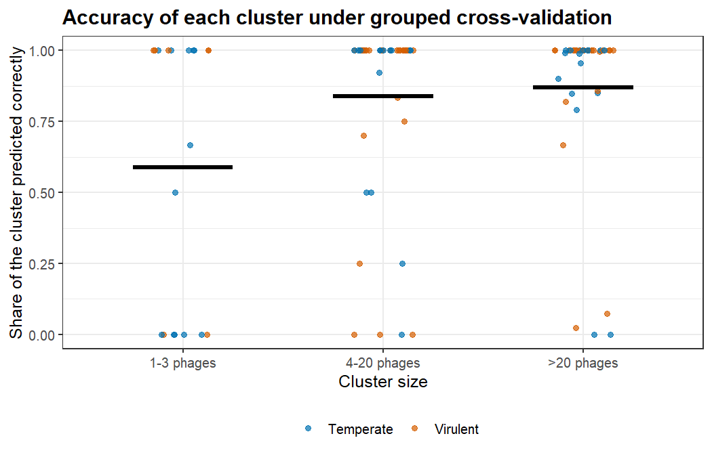
<p class="caption">

Each point is one labelled cluster; the black bar is the mean. Several
small clusters are predicted completely wrong.
</p>

</div>

``` r
unlabeled_sizes <- unlabeled_df %>% count(cluster_id) %>%
  mutate(size_group = cut(n, breaks = c(0, 3, 20, Inf), labels = c("1-3 phages", "4-20 phages", ">20 phages")))
table(unlabeled_sizes$size_group)
```

    ## 
    ##  1-3 phages 4-20 phages  >20 phages 
    ##          75          17           1

When every cluster counts once, accuracy falls from 0.937 to 0.804.
Large clusters are easy and small clusters are hard: mean accuracy is
0.869 for clusters with more than 20 phages, but only 0.588 for clusters
with 1 to 3 phages. This last value rests on only 19 clusters, so it is
uncertain. It still matters, because 75 of the 93 unlabelled cluster
groups have 1 to 3 phages.

## 6.6 Which features help on new clusters? (ablation)

Variable importance in section 5 was measured on a random split. Here we
remove one group of features at a time, refit the random forest, and
measure the loss of AUC under grouped cross-validation. A large loss
means the group carries information that the other features cannot
replace.

``` r
feature_groups <- list(
  "DNA end type"         = "end_type",
  "Host genus"           = "host_genus",
  "Morphotype"           = "morphotype",
  "GC content"           = "gc_percent",
  "Genome size and ORFs" = c("genome_kb", "orfs", "orfs_per_kb"),
  "tRNA and tmRNA genes" = c("t_rnas", "tm_rnas", "t_rnas_per_kb", "tm_rnas_per_kb")
)

oof_auc <- function(prob) as.numeric(auc(roc(tree_data$lifestyle, prob, levels = c("Virulent", "Temperate"), quiet = TRUE)))

# Baseline with the same settings as the reduced models (200 trees, same folds and seed)
set.seed(SEED)
full_auc <- oof_auc(grouped_cv_rf(tree_data, group_folds, ntree = 200))

# Run-to-run variation of the forest: the same full model with three other seeds
seed_aucs <- sapply(1:3, function(s) { set.seed(s); oof_auc(grouped_cv_rf(tree_data, group_folds, ntree = 200)) })
noise <- max(abs(c(seed_aucs, full_auc) - full_auc))

ablation <- data.frame()
for (g in names(feature_groups)) {
  set.seed(SEED)
  prob <- grouped_cv_rf(select(tree_data, -all_of(feature_groups[[g]])), group_folds, ntree = 200)
  g_auc <- oof_auc(prob)
  ablation <- rbind(ablation, data.frame(Removed = g, AUC = g_auc, AUC_lost = full_auc - g_auc,
                                         Balanced_Accuracy = balanced_accuracy(tree_data$lifestyle, prob)))
}
ablation <- arrange(ablation, desc(AUC_lost))
write.csv(ablation, "output/feature_ablation.csv", row.names = FALSE)
knitr::kable(ablation, digits = 3, caption = paste0("Feature ablation under grouped CV (full model AUC = ", r3(full_auc), ")"))
```

| Removed              |   AUC | AUC_lost | Balanced_Accuracy |
|:---------------------|------:|---------:|------------------:|
| Genome size and ORFs | 0.934 |    0.041 |             0.884 |
| GC content           | 0.940 |    0.034 |             0.878 |
| DNA end type         | 0.945 |    0.030 |             0.886 |
| tRNA and tmRNA genes | 0.958 |    0.017 |             0.908 |
| Host genus           | 0.961 |    0.013 |             0.936 |
| Morphotype           | 0.972 |    0.002 |             0.936 |

Feature ablation under grouped CV (full model AUC = 0.974)

``` r
c(full_model_auc = full_auc, largest_change_from_seed_alone = noise)
```

    ##                 full_model_auc largest_change_from_seed_alone 
    ##                    0.974413508                    0.004013762

``` r
ggplot(ablation, aes(x = reorder(Removed, AUC_lost), y = AUC_lost)) +
  geom_col(fill = "grey50") +
  geom_hline(yintercept = noise, linetype = "dotted") +
  coord_flip() +
  labs(title = "Loss of AUC when a feature group is removed", x = "", y = "AUC lost (grouped CV)")
```

<div class="figure" style="text-align: center">

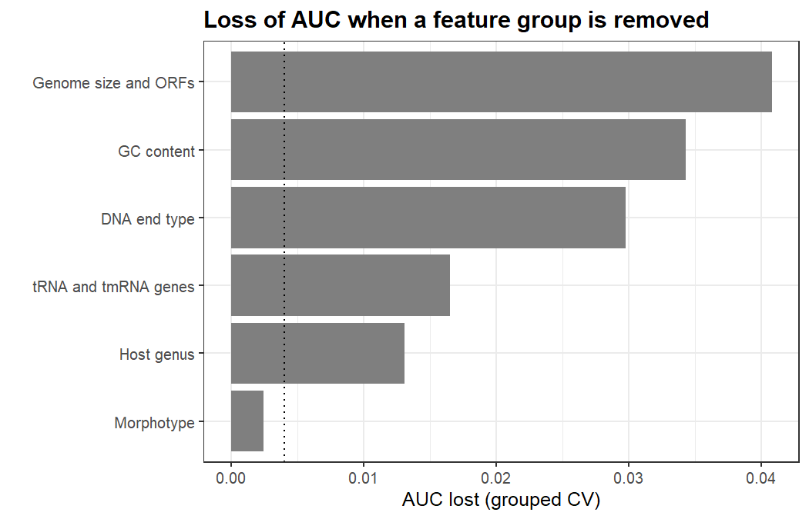
<p class="caption">

AUC lost when each feature group is removed (grouped cross-validation).
The dotted line is the largest change caused by the random seed alone;
bars below it are not real effects.
</p>

</div>

The full model was refitted with three other random seeds, and its AUC
changed by at most 0.004. Differences smaller than this are random
variation of the forest, not real effects.

Removing a single group costs at most 0.041 AUC. The features overlap,
so most of the information in one group is also present in the others.
On new clusters, the three groups with the most unique information are
(in order): Genome size and ORFs; GC content; DNA end type. The two that
add least are Host genus and Morphotype.

This ranking is not the same as the importance plot in section 5, where
end_type came first and host genus was in the top three. Importance on a
random split also rewards features that help recognise known clusters.
Ablation under grouped cross-validation measures what transfers to new
clusters.

## 6.7 Permutation test

Is the held-out-cluster accuracy better than chance? We shuffle the
lifestyle labels **between clusters** (each cluster keeps one label, but
a random one), refit the random forest under grouped 5-fold
cross-validation, and record the balanced accuracy. Repeating this 100
times gives the accuracy we would expect if the features had no link to
lifestyle.

``` r
set.seed(SEED)
perm_folds <- groupKFold(labeled_df$cluster_id, k = 5)

set.seed(SEED)
observed <- balanced_accuracy(tree_data$lifestyle, grouped_cv_rf(tree_data, perm_folds, ntree = 100))

null_values <- numeric(N_PERM)
set.seed(SEED)
for (b in 1:N_PERM) {
  shuffled  <- cluster_summary %>% mutate(perm_lifestyle = sample(lifestyle))
  perm_data <- tree_data
  perm_data$lifestyle <- shuffled$perm_lifestyle[match(labeled_df$cluster_id, shuffled$cluster_id)]
  null_values[b] <- balanced_accuracy(perm_data$lifestyle, grouped_cv_rf(perm_data, perm_folds, ntree = 100))
}
p_value <- (1 + sum(null_values >= observed)) / (N_PERM + 1)
write.csv(data.frame(permutation = 1:N_PERM, balanced_accuracy = null_values),
          "output/permutation_null.csv", row.names = FALSE)

c(observed = observed, null_mean = mean(null_values), null_max = max(null_values), p_value = p_value)
```

    ##   observed  null_mean   null_max    p_value 
    ## 0.84690360 0.47621874 0.76163075 0.00990099

``` r
ggplot(data.frame(null_values), aes(x = null_values)) +
  geom_histogram(bins = 20, color = "white", fill = "grey60") +
  geom_vline(xintercept = observed, colour = "#009E73", linewidth = 1.2) +
  geom_vline(xintercept = 0.5, linetype = "dashed") +
  labs(title = "Balanced accuracy with shuffled cluster labels",
       subtitle = "Green line: real labels. Dashed line: chance (0.5)",
       x = "Balanced accuracy (grouped 5-fold CV)", y = "Permutations")
```

<div class="figure" style="text-align: center">

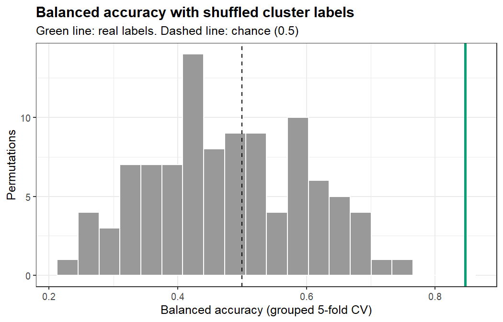
<p class="caption">

Balanced accuracy for 100 shuffles of the cluster labels (grey) and for
the real labels (line). The real value is higher than every shuffled
one.
</p>

</div>

To keep the run time reasonable, this test uses 5 folds and 100 trees,
so the observed value is lower than in 6.4. What matters is the
comparison with the shuffled labels, which use exactly the same
settings.

With the real labels, balanced accuracy is 0.847. With shuffled labels
it averages 0.476, which is chance level, and never goes above 0.762.
The p-value is 0.010, the smallest value possible with 100 permutations.
So the features carry real information about lifestyle, even for
clusters the model has never seen.

# 7. Unsupervised learning

PCA and clustering use only the eight standardised numeric features.
Lifestyle, morphotype and host are used afterwards to interpret the
result.

``` r
unsup_df <- labeled_df %>% select(lifestyle, morphotype, host_genus, all_of(numeric_vars))
X_scaled <- scale(unsup_df[, numeric_vars])
life_lab  <- unsup_df$lifestyle
morph_lab <- unsup_df$morphotype
host_lab  <- unsup_df$host_genus
```

## 7.1 PCA

``` r
pca_res <- prcomp(X_scaled, center = FALSE, scale. = FALSE)
pve     <- pca_res$sdev^2 / sum(pca_res$sdev^2)

pve_df <- data.frame(PC = seq_along(pve), pve = pve, cumulative = cumsum(pve))
s1 <- ggplot(pve_df, aes(x = PC, y = pve)) + geom_line() + geom_point(size = 2) +
  scale_x_continuous(breaks = pve_df$PC) +
  labs(title = "Scree plot", x = "Principal component", y = "Proportion of variance")
s2 <- ggplot(pve_df, aes(x = PC, y = cumulative)) + geom_line() + geom_point(size = 2) +
  geom_hline(yintercept = 0.9, linetype = "dotted") +
  scale_x_continuous(breaks = pve_df$PC) +
  labs(title = "Cumulative", x = "Principal component", y = "Cumulative proportion")
s1 + s2
```

<div class="figure" style="text-align: center">

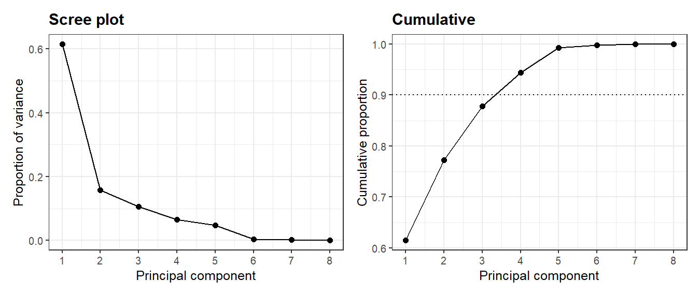
<p class="caption">

Variance explained by each principal component. The dotted line marks
90%.
</p>

</div>

``` r
round(pca_res$rotation[, 1:4], 3)
```

    ##                   PC1    PC2    PC3    PC4
    ## genome_kb       0.402  0.011 -0.266 -0.513
    ## gc_percent     -0.123  0.567 -0.746  0.239
    ## orfs            0.389 -0.197 -0.358 -0.415
    ## t_rnas          0.435  0.052  0.076  0.048
    ## tm_rnas         0.414  0.173  0.041  0.337
    ## orfs_per_kb     0.006 -0.765 -0.440  0.433
    ## t_rnas_per_kb   0.386 -0.017  0.192  0.168
    ## tm_rnas_per_kb  0.402  0.147  0.081  0.421

``` r
fviz_pca_biplot(pca_res, axes = c(1, 2), geom.ind = "point", col.ind = life_lab,
                palette = unname(life_cols), alpha.ind = 0.4, pointsize = 1,
                addEllipses = TRUE, label = "var", col.var = "black", repel = TRUE,
                title = "PCA biplot coloured by lifestyle", ggtheme = theme_bw()) +
  labs(colour = "", fill = "", shape = "") +
  theme(plot.title = element_text(face = "bold"), legend.position = "bottom")
```

<div class="figure" style="text-align: center">

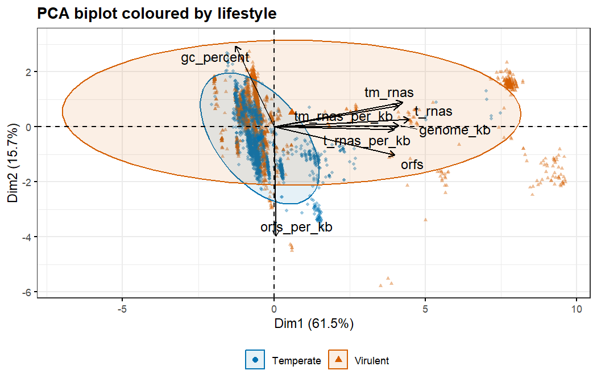
<p class="caption">

PCA biplot coloured by lifestyle. The two lifestyles overlap except for
large, RNA-rich virulent genomes at high PC1.
</p>

</div>

``` r
scores_df <- data.frame(PC1 = pca_res$x[, 1], PC2 = pca_res$x[, 2], morphotype = morph_lab)
ggplot(scores_df, aes(PC1, PC2, color = morphotype)) +
  geom_point(alpha = 0.5, size = 1) +
  labs(title = "PCA coloured by morphotype", color = "")
```

<div class="figure" style="text-align: center">

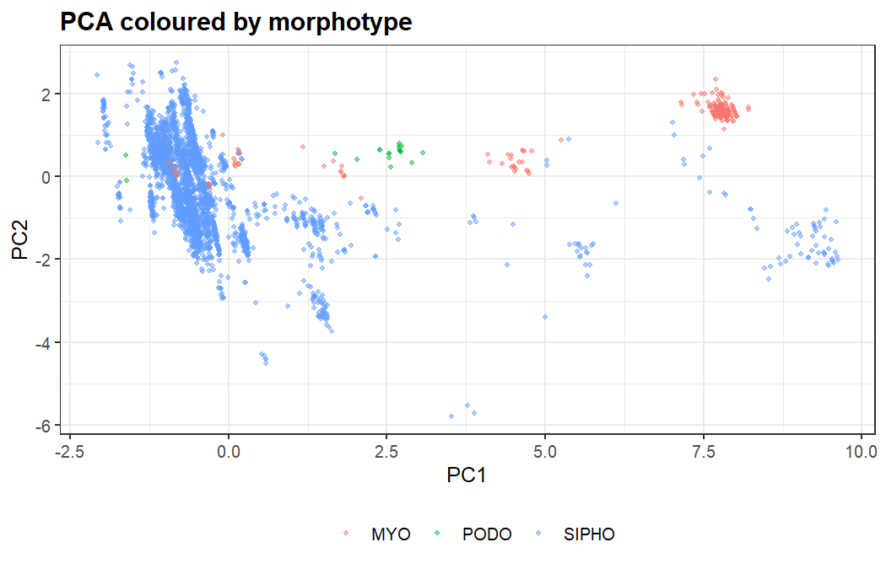
<p class="caption">

The same PCA coloured by morphotype, which shows more structure than
lifestyle.
</p>

</div>

PC1 explains 61.5% of the variance and the first two components 77.2%.
PC1 is a “genome size and RNA genes” axis: it loads on genome length,
ORF count and all tRNA/tmRNA variables. PC2 opposes GC content and
coding density. Temperate and virulent phages overlap almost completely,
except for a group of large, RNA-rich virulent genomes at high PC1.
Morphotype shows more structure than lifestyle.

## 7.2 k-means

``` r
set.seed(SEED)
wss <- sapply(1:10, function(k) kmeans(X_scaled, centers = k, nstart = 25)$tot.withinss)
dist_mat <- dist(X_scaled, method = "euclidean")
avg_sil  <- sapply(2:10, function(k) {
  km <- kmeans(X_scaled, centers = k, nstart = 25)
  mean(silhouette(km$cluster, dist_mat)[, "sil_width"])
})

k1 <- ggplot(data.frame(k = 1:10, wss = wss), aes(x = k, y = wss)) + geom_line() + geom_point(size = 2) +
  scale_x_continuous(breaks = 1:10) +
  labs(title = "Elbow plot", x = "Number of clusters k", y = "Total within-cluster SS")
k2 <- ggplot(data.frame(k = 2:10, sil = avg_sil), aes(x = k, y = sil)) + geom_line() + geom_point(size = 2) +
  scale_x_continuous(breaks = 2:10) +
  labs(title = "Silhouette", x = "Number of clusters k", y = "Average silhouette width")
k1 + k2
```

<div class="figure" style="text-align: center">

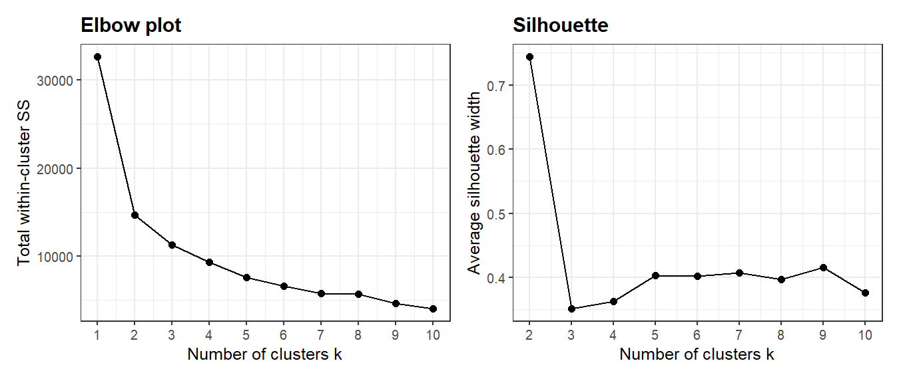
<p class="caption">

Choosing k. The elbow flattens after k = 2 to 3, and the average
silhouette is highest at k = 2.
</p>

</div>

``` r
set.seed(SEED)
km2 <- kmeans(X_scaled, centers = 2, nstart = 50)
km3 <- kmeans(X_scaled, centers = 3, nstart = 50)

table(kmeans_cluster = km2$cluster, life_lab)
```

    ##               life_lab
    ## kmeans_cluster Temperate Virulent
    ##              1         8      284
    ##              2      2246     1545

``` r
table(kmeans_cluster = km3$cluster, morph_lab)
```

    ##               morph_lab
    ## kmeans_cluster  MYO PODO SIPHO
    ##              1   34    8  2041
    ##              2  201    0    87
    ##              3   23   20  1669

``` r
unsup_df %>% mutate(kmeans_cluster = km3$cluster) %>%
  group_by(kmeans_cluster) %>%
  summarise(n = n(), across(all_of(numeric_vars), mean)) %>%
  knitr::kable(digits = 2, caption = "Mean feature values in each k-means cluster (k = 3)")
```

| kmeans_cluster | n | genome_kb | gc_percent | orfs | t_rnas | tm_rnas | orfs_per_kb | t_rnas_per_kb | tm_rnas_per_kb |
|---:|---:|---:|---:|---:|---:|---:|---:|---:|---:|
| 1 | 2083 | 53.25 | 65.31 | 80.03 | 0.27 | 0.00 | 1.51 | 0.01 | 0.00 |
| 2 | 288 | 149.72 | 60.92 | 231.52 | 33.12 | 0.86 | 1.56 | 0.22 | 0.01 |
| 3 | 1712 | 60.12 | 61.71 | 107.61 | 1.98 | 0.00 | 1.78 | 0.03 | 0.00 |

Mean feature values in each k-means cluster (k = 3)

``` r
scores_df$kmeans_k3 <- factor(km3$cluster)
ggplot(scores_df, aes(PC1, PC2, color = kmeans_k3)) +
  geom_point(alpha = 0.5, size = 1) +
  scale_color_manual(values = c("#009E73", "#CC79A7", "grey40")) +
  labs(title = "k-means clusters (k = 3) on the PCA plane", color = "k-means cluster")
```

<div class="figure" style="text-align: center">

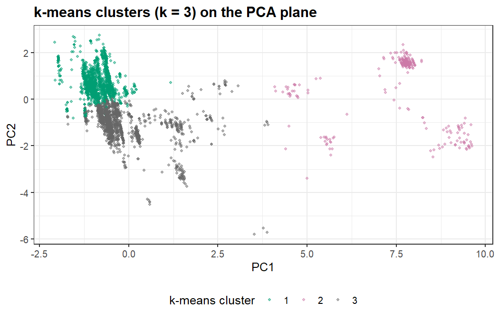
<p class="caption">

The three k-means clusters shown on the first two principal components.
The groups follow genome size (PC1) and GC content / coding density
(PC2), not lifestyle.
</p>

</div>

The silhouette is highest at k = 2, but this split separates a small
group of about 292 large, RNA-rich, mostly virulent genomes from
everything else. With k = 3, one group holds the large myovirus genomes
and two groups hold typical siphoviruses that differ in GC content and
coding density. k-means finds genome architecture and morphotype, not
lifestyle.

## 7.3 Hierarchical clustering

``` r
hc_complete <- hclust(dist_mat, method = "complete")
hc_average  <- hclust(dist_mat, method = "average")
hc_single   <- hclust(dist_mat, method = "single")
hc_ward     <- hclust(dist_mat, method = "ward.D2")

par(mfrow = c(1, 4))
plot(hc_complete, labels = FALSE, main = "Complete", xlab = "", sub = "")
plot(hc_average,  labels = FALSE, main = "Average",  xlab = "", sub = "")
plot(hc_single,   labels = FALSE, main = "Single",   xlab = "", sub = "")
plot(hc_ward,     labels = FALSE, main = "Ward",     xlab = "", sub = "")
```

<div class="figure" style="text-align: center">

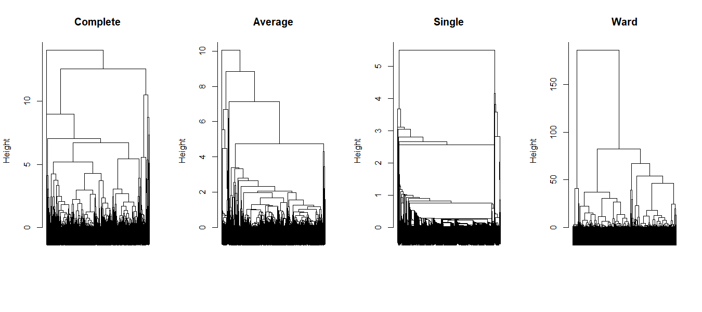
<p class="caption">

Dendrograms with four linkage methods on the same standardised features.
Single linkage chains phages together; Ward linkage gives the most
balanced groups.
</p>

</div>

``` r
par(mfrow = c(1, 1))

table(complete_k3 = cutree(hc_complete, k = 3), morph_lab)
```

    ##            morph_lab
    ## complete_k3  MYO PODO SIPHO
    ##           1   47   28  3650
    ##           2  211    0   134
    ##           3    0    0    13

``` r
table(ward_k2 = cutree(hc_ward, k = 2), life_lab)
```

    ##        life_lab
    ## ward_k2 Temperate Virulent
    ##       1      2246     1589
    ##       2         8      240

Single linkage chains most phages into one group. Complete linkage at k
= 3 gives one large siphovirus group, a myovirus-rich group and a few
outliers. Ward linkage gives more balanced groups, and at k = 2 it again
isolates the large virulent genomes. All three unsupervised methods
agree with PCA: the main structure is genome size, RNA genes and
morphotype. Lifestyle needs a supervised model.

# 8. Predicting the unlabelled phages

The random forest is refitted on all labelled phages and applied to the
237 unlabelled ones. Some unlabelled phages have a host genus or
morphotype that never appears in the labelled data, so a second forest
without these two variables is used for them.

``` r
set.seed(SEED)
rf_final  <- randomForest(lifestyle ~ ., data = tree_data, mtry = floor(sqrt(p)), ntree = 500)
set.seed(SEED)
rf_backup <- randomForest(lifestyle ~ ., data = select(tree_data, -host_genus, -morphotype), ntree = 500)

new_data <- unlabeled_df %>% select(all_of(names(tree_data)[-1]))
for (v in c("morphotype", "end_type", "host_genus")) {
  new_data[[v]] <- factor(as.character(new_data[[v]]), levels = levels(tree_data[[v]]))
}
known <- complete.cases(new_data)
cat("Phages with a host or morphotype not seen in training:", sum(!known), "\n")
```

    ## Phages with a host or morphotype not seen in training: 18

``` r
prob_temperate <- numeric(nrow(new_data))
prob_temperate[known]  <- predict(rf_final,  new_data[known, ],  type = "prob")[, "Temperate"]
prob_temperate[!known] <- predict(rf_backup, new_data[!known, ], type = "prob")[, "Temperate"]

unlabeled_results <- unlabeled_df %>%
  select(phage_name, cluster, host_genus, morphotype, genome_kb, gc_percent, end_type) %>%
  mutate(prob_temperate      = round(prob_temperate, 3),
         predicted_lifestyle = ifelse(prob_temperate > 0.5, "Temperate", "Virulent"),
         confidence          = ifelse(abs(prob_temperate - 0.5) >= 0.3, "high", "low"),
         model_used          = ifelse(known, "random forest", "forest without host/morphotype")) %>%
  arrange(desc(prob_temperate))
write.csv(unlabeled_results, "output/unlabelled_predictions.csv", row.names = FALSE)

table(predicted = unlabeled_results$predicted_lifestyle, confidence = unlabeled_results$confidence)
```

    ##            confidence
    ## predicted   high low
    ##   Temperate   29  27
    ##   Virulent   136  45

``` r
table(predicted = unlabeled_results$predicted_lifestyle, morphotype = unlabeled_results$morphotype)
```

    ##            morphotype
    ## predicted   MYO PODO SIPHO TECTI
    ##   Temperate   0    0    56     0
    ##   Virulent   19   41   118     3

We predict 56 temperate and 181 virulent phages. All myoviruses and
podoviruses are predicted virulent, which matches the labelled data
(almost every labelled myovirus and every labelled podovirus is
virulent). The three tectiviruses are also predicted virulent, but there
are no labelled tectiviruses to compare them with. None of these phages
has a labelled relative, so the 99% of section 5 does not apply to them.
Most of them are in clusters of 1 to 3 phages, where grouped
cross-validation gave only about 59% accuracy. These predictions are
hypotheses to test, not final labels. The `confidence` column
(probability at least 0.3 away from 0.5) can be used to choose phages
for lab confirmation.

# 9. Conclusions

1.  **Data.** We kept 4320 finished genomes. Lifestyle is constant
    within each of the 104 labelled clusters, so the phages are not
    independent observations. This shaped the whole analysis.
2.  **Regression.** Genome size depends mainly on morphotype and host
    (adjusted R² = 0.54). Virulent phages tend to have larger genomes,
    but the difference is not significant when each cluster counts once
    (p = 0.11).
3.  **Classical classifiers.** Logistic regression, LDA and QDA reach
    about 85% accuracy on a random split. Higher coding density and GC
    content and a shorter genome go with a temperate lifestyle. Variable
    selection removes two redundant variables without loss, and the
    threshold has little effect because the classes are balanced.
4.  **Trees and ensembles.** Using DNA end type, host and morphotype,
    trees and ensembles reach about 99% accuracy on a random split.
5.  **Validation.** The 99% is inflated by related phages in the
    training and test sets. A baseline that only looks up the cluster
    scores 0.998. On new clusters the random forest reaches about 80% to
    94% depending on how clusters are weighted, and only about 59% on
    very small clusters. A permutation test confirms the model is better
    than chance (p = 0.010). Genome size, GC content and end type carry
    the information that transfers to new clusters.
6.  **Unsupervised learning.** PCA, k-means and hierarchical clustering
    group phages by genome size, RNA genes and morphotype, not by
    lifestyle.
7.  **Prediction.** We give predictions for 237 unlabelled phages. Their
    accuracy is expected to be lower than our validation average,
    because most of them are in very small clusters.

The main lesson is that **the way a model is validated must match the
way it will be used**. A random split answers “can the model recognise
phages similar to ones it has seen?”. Holding out clusters answers “can
it predict phages from new groups?”. Only the second question matters
for the unlabelled phages.

**Limitations.** Lifestyle labels in PhagesDB may have been assigned per
cluster rather than tested for every phage. The data are dominated by
siphoviruses and *Mycobacterium* hosts. The features are genome
summaries, not the genes that actually make a phage temperate (for
example integrase and repressor genes). Natural next steps are to add
such gene features and to confirm a sample of predictions in the lab.

# Session information

``` r
sessionInfo()
```

    ## R version 4.5.1 (2025-06-13 ucrt)
    ## Platform: x86_64-w64-mingw32/x64
    ## Running under: Windows 11 x64 (build 26200)
    ## 
    ## Matrix products: default
    ##   LAPACK version 3.12.1
    ## 
    ## locale:
    ## [1] LC_COLLATE=English_United States.utf8  LC_CTYPE=English_United States.utf8    LC_MONETARY=English_United States.utf8
    ## [4] LC_NUMERIC=C                           LC_TIME=English_United States.utf8    
    ## 
    ## time zone: Asia/Beirut
    ## tzcode source: internal
    ## 
    ## attached base packages:
    ## [1] stats     graphics  grDevices utils     datasets  methods   base     
    ## 
    ## other attached packages:
    ##  [1] patchwork_1.3.2      cluster_2.1.8.1      factoextra_1.0.7     gbm_2.2.2            randomForest_4.7-1.2
    ##  [6] rpart.plot_3.1.3     rpart_4.1.24         bestglm_0.37.3       leaps_3.2            boot_1.3-31         
    ## [11] caret_7.0-1          lattice_0.22-7       pROC_1.19.0.1        MASS_7.3-65          ggplot2_4.0.0       
    ## [16] stringr_1.5.2        tidyr_1.3.1          dplyr_1.1.4          readxl_1.4.5        
    ## 
    ## loaded via a namespace (and not attached):
    ##  [1] rlang_1.1.6          magrittr_2.0.4       e1071_1.7-16         compiler_4.5.1       vctrs_0.6.5         
    ##  [6] reshape2_1.4.4       pkgconfig_2.0.3      shape_1.4.6.1        fastmap_1.2.0        backports_1.5.0     
    ## [11] labeling_0.4.3       rmarkdown_2.30       prodlim_2025.04.28   purrr_1.1.0          xfun_0.53           
    ## [16] glmnet_4.1-10        cachem_1.1.0         jsonlite_2.0.0       recipes_1.3.1        broom_1.0.10        
    ## [21] parallel_4.5.1       R6_2.6.1             bslib_0.9.0          stringi_1.8.7        RColorBrewer_1.1-3  
    ## [26] parallelly_1.45.1    car_3.1-3            lubridate_1.9.4      jquerylib_0.1.4      cellranger_1.1.0    
    ## [31] Rcpp_1.1.0           iterators_1.0.14     knitr_1.50           future.apply_1.20.0  Matrix_1.7-3        
    ## [36] splines_4.5.1        nnet_7.3-20          timechange_0.3.0     tidyselect_1.2.1     rstudioapi_0.17.1   
    ## [41] abind_1.4-8          yaml_2.3.10          timeDate_4051.111    codetools_0.2-20     listenv_0.10.0      
    ## [46] tibble_3.3.0         plyr_1.8.9           withr_3.0.2          S7_0.2.0             evaluate_1.0.5      
    ## [51] future_1.67.0        survival_3.8-3       proxy_0.4-27         grpreg_3.5.0         pillar_1.11.1       
    ## [56] ggpubr_0.6.2         carData_3.0-5        foreach_1.5.2        stats4_4.5.1         generics_0.1.4      
    ## [61] scales_1.4.0         globals_0.18.0       class_7.3-23         glue_1.8.0           tools_4.5.1         
    ## [66] data.table_1.17.8    ModelMetrics_1.2.2.2 gower_1.0.2          ggsignif_0.6.4       grid_4.5.1          
    ## [71] ipred_0.9-15         nlme_3.1-168         Formula_1.2-5        cli_3.6.5            lava_1.8.2          
    ## [76] gtable_0.3.6         pls_2.8-5            rstatix_0.7.3        sass_0.4.10          digest_0.6.37       
    ## [81] ggrepel_0.9.6        farver_2.1.2         htmltools_0.5.8.1    lifecycle_1.0.4      hardhat_1.4.2
